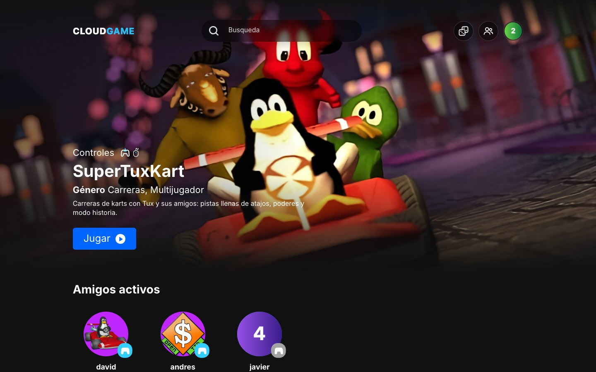
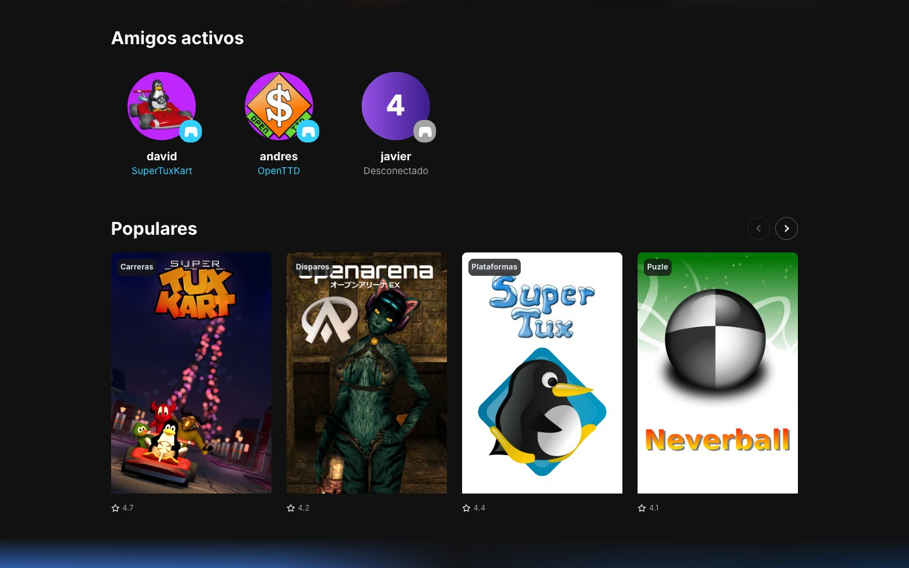
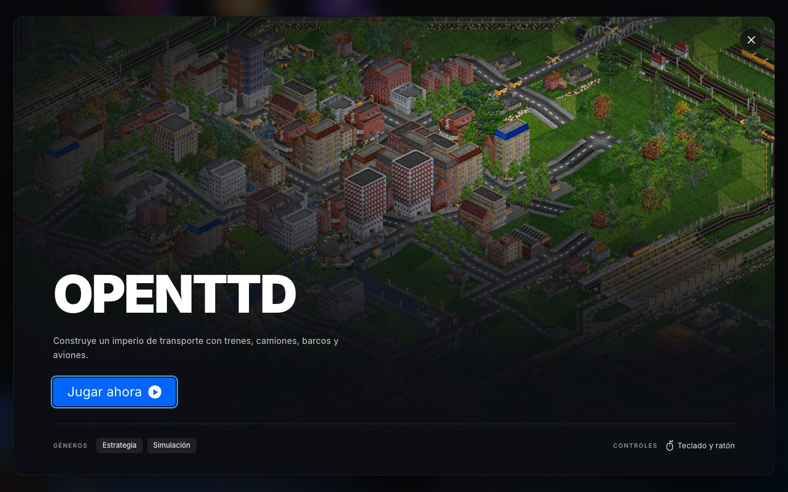
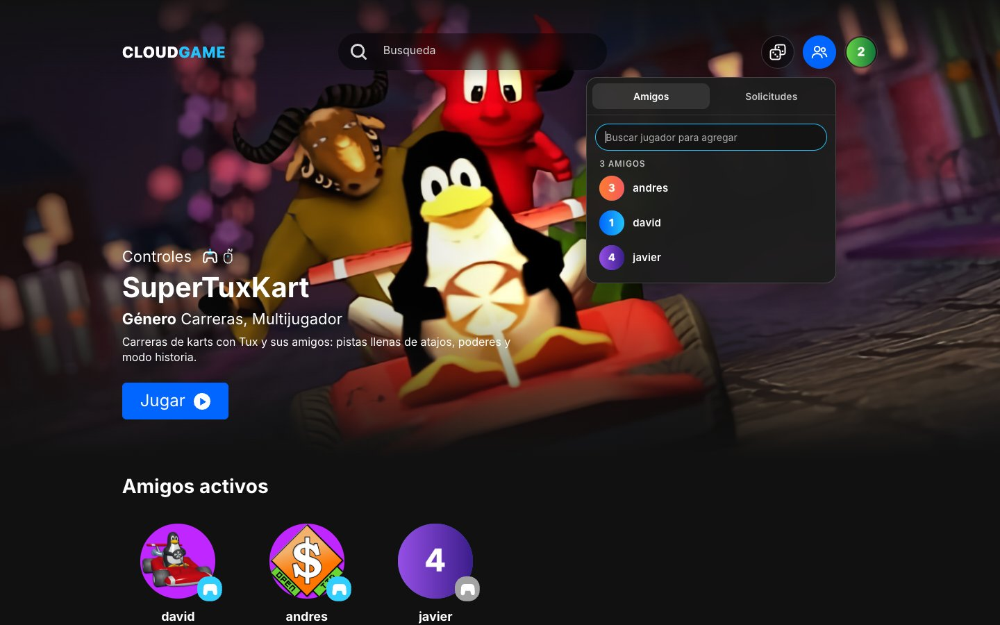
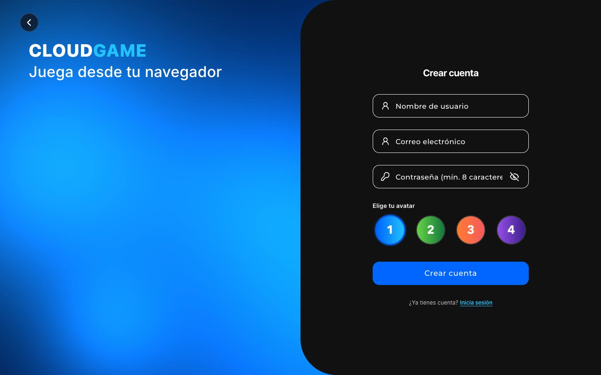
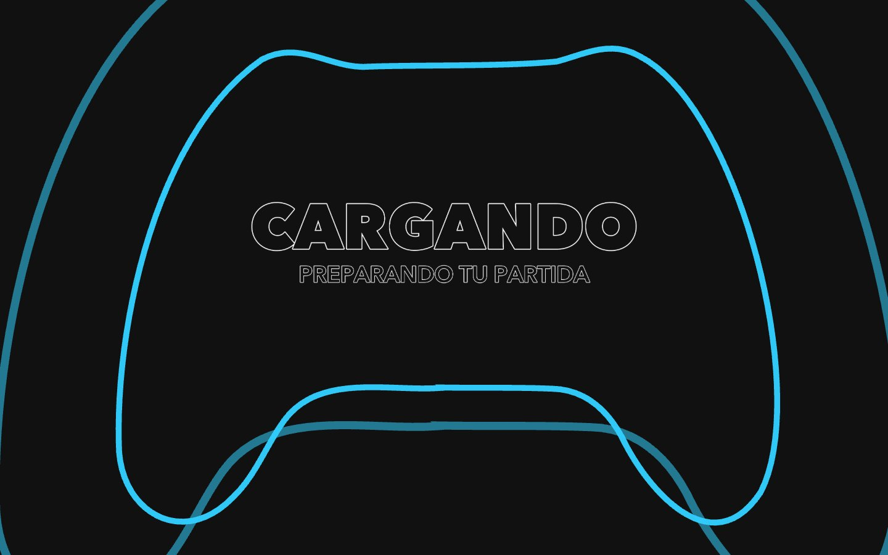
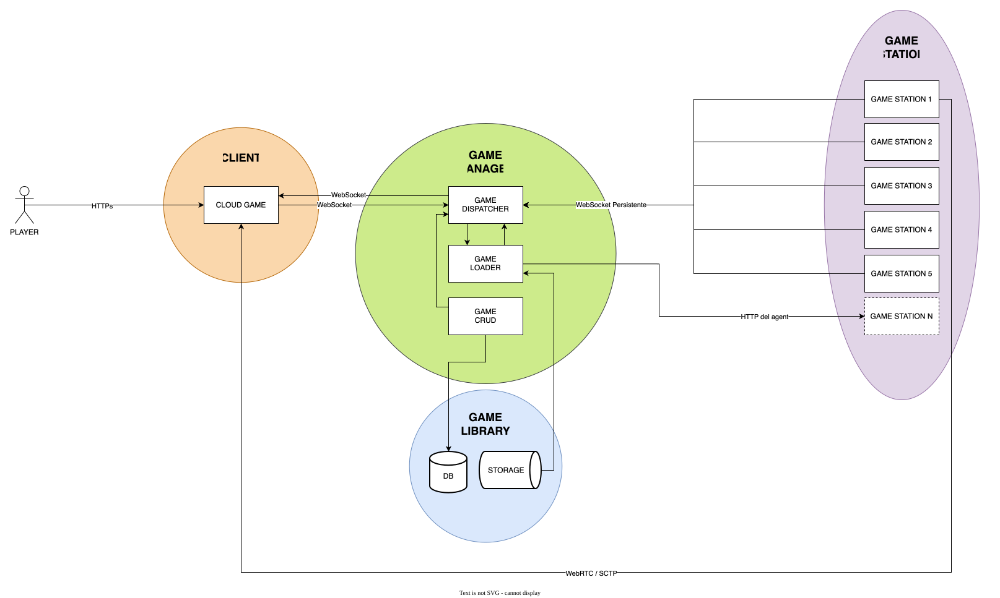

# Cloud Game

> **English:** Cloud-gaming platform built during my internship. Linux games run in containers on a server and are
> played from the browser over WebRTC, with gamepad, keyboard and mouse input sent back over a low-latency
> DataChannel. Java/Spring Boot services, React client, Docker. Documentation is in Spanish.

Plataforma de **cloud gaming**: los juegos corren en contenedores Linux en un servidor y se juegan desde el
**navegador**, con el video y el audio transmitidos por **WebRTC** y el input (gamepad, teclado y mouse) de vuelta
por un canal de baja latencia. Cada partida tiene su propia estación, que se crea cuando hace falta y vuelve a un
pool al terminar.

> **Proyecto de pasantías.** Desarrollado durante mis pasantías profesionales. Esta es una versión independiente,
> publicada como muestra de portafolio.

| Inicio | Catálogo y amigos activos |
|---|---|
|  |  |
| **Ficha de un juego** | **Amigos** |
|  |  |
| **Crear cuenta** | **Preparando la partida** |
|  |  |

<sub>Capturas del cliente web con un catálogo de demostración de juegos libres. Ilustraciones de los juegos:
[SteamGridDB](https://www.steamgriddb.com).</sub>

## Características

- **Juegos en el navegador** sin instalar nada: el servidor ejecuta el juego en un display virtual y lo transmite
  por WebRTC (RTP/SRTP sobre UDP), con upscaling FSR en el cliente.
- **Input remoto** de gamepad, teclado y mouse por un DataChannel a 250 Hz, inyectado en la estación como mandos
  virtuales (`uinput`/SDL, hasta 4) y eventos X11.
- **Una estación por partida**: el dispatcher reutiliza estaciones libres, mantiene un pool mínimo por juego, pone a
  los jugadores en cola cuando no hay cupo y libera las inactivas; el loader crea y destruye los contenedores.
- **Cuentas de jugador**: registro e inicio de sesión (bcrypt + JWT), avatar, amigos y partidas guardadas en el
  servidor, que se recuperan en cualquier estación.
- **22 juegos**: SuperTuxKart, títulos libres de Ubuntu (SuperTux, Neverball, OpenTTD, OpenArena, Freedoom…),
  DevilutionX y ports decompilados que requieren ROM propia. Catálogo completo en [`games/`](games/README.md).
- **Panel de administración** del catálogo, **documentación de APIs** con Scalar y **sitio de documentación** con
  Starlight.
- **Despliegue con Docker Compose** en un servidor Linux, HTTPS autofirmado o Let's Encrypt, GPU NVIDIA opcional, y
  tests y builds automáticos en GitHub Actions.

## Cómo funciona



El jugador entra al cliente web y pide un juego. El **Game Dispatcher** le asigna una estación libre o le pide al
**Game Loader** que cree una; la **Game Station** ejecuta el juego, transmite la pantalla y el audio por WebRTC y
recibe el input. **Game Crud** guarda el catálogo, las cuentas y las partidas. El detalle está en la
[arquitectura](docs/arquitectura.md).

## Inicio rápido

En un servidor Linux con Docker (Compose v2) y `/dev/uinput`:

```bash
git clone https://github.com/marcelopcx/cloud-game.git
cd cloud-game
./scripts/deploy-loader.sh
```

El script detecta la IP del servidor, completa el `.env`, construye los juegos, el loader y el cliente, y levanta
todo. Al terminar, la plataforma queda en **https://IP-DEL-SERVIDOR/**.
Para reconstruir solo algunos juegos: `./scripts/deploy-loader.sh supertux`; para bajar todo:
`./scripts/deploy-loader.sh --down`.
Los otros modos de despliegue, las variables y el HTTPS con Let's Encrypt están en el
[despliegue](docs/despliegue.md).

## Componentes

| Componente | Para qué | Tecnología |
|---|---|---|
| [**Game Station**](docs/game-station/README.md) | Ejecuta el juego, captura video y audio, negocia WebRTC e inyecta el input | Java 21, Spring Boot, webrtc-java |
| [**Game Dispatcher**](docs/game-dispatcher/README.md) | Asigna estaciones: reutiliza, encola, mantiene el pool y libera las inactivas | Java 21, Spring Boot |
| [**Game Loader**](docs/game-loader/README.md) | Crea y destruye los contenedores de estación en el host | Java 21, Spring Boot, docker-java |
| [**Game Client**](docs/game-client/README.md) | Web del jugador: catálogo, ficha del juego, reproductor, cuentas y amigos | React 19, TypeScript, Vite |
| [**Game Crud**](docs/game-crud/README.md) | API del catálogo, las cuentas de jugador y las partidas guardadas | Java 21, Spring Boot, PostgreSQL |
| [**Game Admin**](docs/game-admin/README.md) | Panel para administrar el catálogo | React 19, TypeScript |
| [**Juegos**](games/README.md) | Una imagen Docker por juego, con su manifiesto | Docker |

## Documentación

| Documento | Contenido |
|---|---|
| [Arquitectura](docs/arquitectura.md) | Diagramas, flujo de una partida y estados de la estación |
| [Despliegue](docs/despliegue.md) | Modos de despliegue, `.env`, Compose, TLS, CI/CD, uinput y firewall |
| [API de la estación](docs/game-station/api.md) | REST, WebSockets y códigos de error |
| [Video, audio y red](docs/game-station/media.md) | Captura, codificación e ICE |
| [Input remoto](docs/game-station/input.md) | Protocolo del DataChannel y backends de gamepad |
| [Agregar un juego](docs/games/README.md) | Manifiesto, imagen Docker y requisitos |
| [Documentación de APIs](game-api/README.md) | Referencia interactiva con Scalar en `/api-docs/` |
| [Sitio de documentación](docs/game-docs/README.md) | Toda esta documentación en `/docs/`, con buscador y modo oscuro |

## Estructura del proyecto

```
game-station/        estación: runtime Java e imagen base Docker
game-dispatcher/     asignación de estaciones
game-loader/         creación y borrado de contenedores de estación
game-client/         web del jugador y nginx
game-crud/           API del catálogo, cuentas y partidas guardadas
game-admin/          panel del catálogo
game-api/            documentación de APIs (Scalar)
game-docs/           sitio de documentación (Starlight)
games/               una carpeta por juego (Dockerfile + manifest.yaml)
scripts/             despliegue, CI/CD y diagnóstico
docs/                documentación y diagramas (draw.io)
compose.loader.yaml  despliegue por defecto
.env.example         plantilla de configuración
```

---

<p align="center"><em>Dedicated to Javier Pérez (@kaucrow)</em></p>
