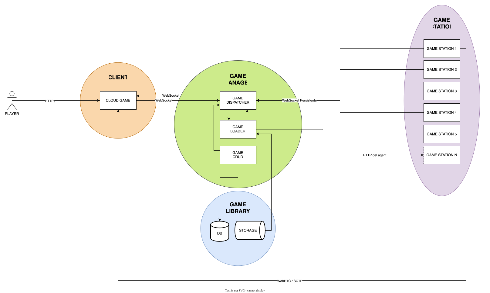
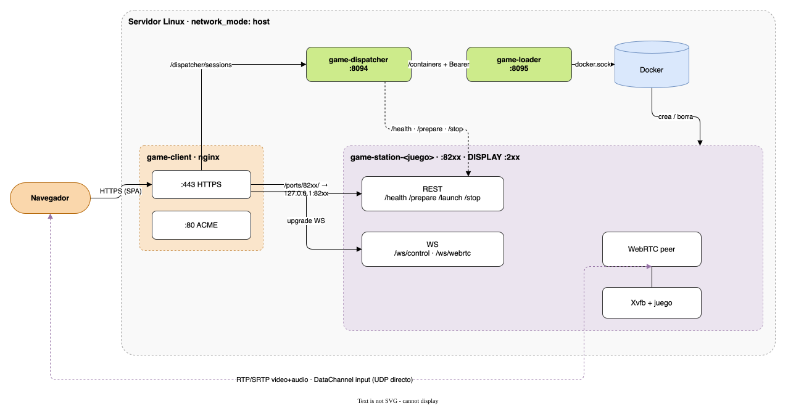
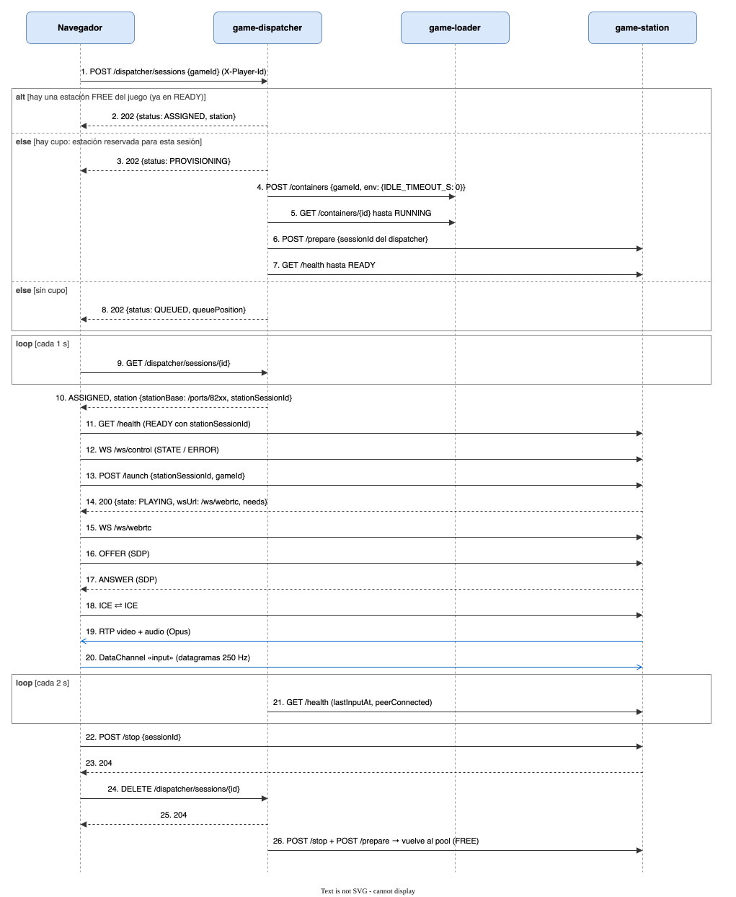
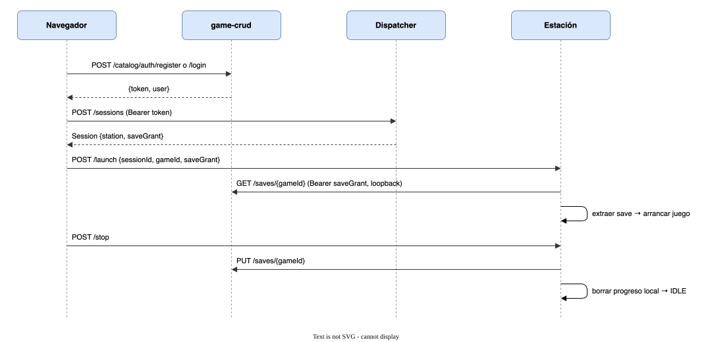
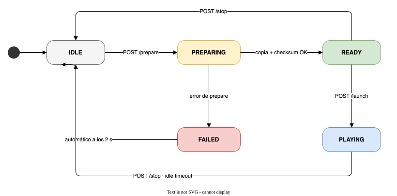

# Arquitectura

Este documento describe la arquitectura objetivo de Cloud Game, tomada del
diagrama estructural [`diagrams/arquitectura.drawio.svg`](diagrams/arquitectura.drawio.svg),
y la contrasta con lo que hoy está implementado en el repositorio.

## Diagrama estructural

| Bloque | Rol según el diagrama |
| --- | --- |
| **Player** | Usuario final que juega desde el navegador. |
| **Client — Cloud Game** | Aplicación web con la que interactúa el jugador. |
| **GameManager — Game Dispatcher** | Punto central entre el cliente y el pool de estaciones; se comunica con el Loader y con la DB. |
| **GameManager — Game Loader** | Trabaja con el Dispatcher y accede a la DB y al Storage de la librería. |
| **GameStation 1..N** | Pool de estaciones que ejecutan los juegos y se reportan al Dispatcher. |
| **GameLibrary — DB / Storage** | Base de datos y almacenamiento de la librería de juegos. |

## Estado de implementación

| Bloque del diagrama | En el repositorio | Estado |
| --- | --- | --- |
| Client | [`game-client/`](../game-client) | **Implementado.** SPA React servida por nginx. |
| Game Station | [`game-station/`](../game-station) + [`games/`](../games) | **Implementado.** Cada contenedor de estación sirve un solo juego y un solo jugador. |
| Game Dispatcher | [`game-dispatcher/`](../game-dispatcher) + [`docs/game-dispatcher/`](game-dispatcher/README.md) | **Implementado.** Recibe las solicitudes de partida (`/dispatcher/sessions`), reutiliza estaciones libres, pide al loader las que faltan reservadas para quien las pidió, encola sin cupo, mantiene `minContainers` por juego y libera por inactividad. Estado en memoria; no usa la DB más que para leer el catálogo. |
| Game Loader | [`game-loader/`](../game-loader) + [`docs/game-loader/`](game-loader/README.md) | **Implementado.** Un único servicio que administra N contenedores de estación en el host vía Docker; solo lo usa el dispatcher (`compose.loader.yaml`). La preparación de assets la sigue haciendo la propia estación (`POST /prepare`), que copia desde una library local. |
| DB | [`game-crud/`](../game-crud) + [`docs/game-crud/`](game-crud/README.md) | **Implementado.** PostgreSQL con el catálogo; el home lo lee de game-crud (`/catalog/`, solo lectura) y se edita en game-admin. |
| Storage | — | **No implementado.** La "library" vive dentro de la imagen de la estación (`/opt/station-library`), generada por `station-seed-library`, con un `payload.bin` de 32 MB y su checksum. |

Limitaciones actuales que se derivan de lo anterior:

- El catálogo del cliente está hardcodeado: los 22 `gameId` de `games/` están en el mock. Si se agrega un juego hay que sumarlo ahí.
- Un solo host: el loader crea estaciones solo en su propia máquina, hasta `LOADER_MAX_CONTAINERS`.
- No hay usuarios: el dispatcher identifica al jugador con un id anónimo del browser (`X-Player-Id`), suficiente para la reserva y una partida por jugador, pero no para control de acceso.
- `source.type` en `/prepare` solo acepta `local`. `http` y `azure-sas` responden `UNSUPPORTED_SOURCE`.
- Una estación atiende un solo peer WebRTC a la vez. Una segunda conexión recibe `PEER_BUSY`.

## Topología del despliegue actual

Modo por defecto (`compose.loader.yaml`, el que usa el CI/CD):

- `compose.loader.yaml` define `game-loader` (con `/var/run/docker.sock` montado) y `game-client`. Las estaciones no están en el compose: las crea el loader con la imagen `cloudgame/game-station-<gameId>` y labels `org.cloudgame.*`.
- El slot *i* usa HTTP `8200+i` y `DISPLAY=:(200+i)`. nginx llega a cada estación por `/ports/<puerto>/` sin regenerar configuración.
- REST y WebSocket pasan por nginx. **El media no**: el video, el audio y el DataChannel de input viajan por UDP directo entre el navegador y la estación, usando los candidatos ICE que anuncia la estación (`ICE_HOST_IPS`).

Modos alternativos (comparten los puertos 443/5173, así que se levanta uno solo):

| Modo | Compose | Cliente → estación |
| --- | --- | --- |
| Una estación fija (`deploy.sh`) | `compose.yaml` (`runtime`, `game-station` en `:8090`, `game-client`) | `/station/` |
| Una estación por juego (`deploy-all.sh`) | `compose.multi.yaml` generado (`8100+i`, `:100+i`) | `/stations/<gameId>/` |

## Flujo de una partida

Si la estación no viene en `READY` con su sesión (p. ej. el jugador hizo `/stop` y vuelve a jugar), el cliente sigue el flujo clásico `prepare → READY → launch` sobre la misma estación. Reglas de cola, pool mínimo e inactividad: [docs/game-dispatcher](game-dispatcher/README.md).

Sin dispatcher (`deploy.sh` / `deploy-all.sh`) el flujo arranca directamente en `GET /health` con `prepare → READY → launch`.

### Progreso de los jugadores

- **Anónimo** (`X-Player-Id`): al terminar la partida, el `stop` de la estación borra el progreso
  (cache, `HOME` y `saves` del manifiesto), así el siguiente jugador arranca limpio.
- **Con sesión**: el login pasa por game-crud, que firma un token. Con ese token el dispatcher entrega
  un `saveGrant` junto con la estación. La estación lo recibe en `launch`, baja el save de game-crud y
  lo restaura antes de arrancar el juego. En `stop`, sube el progreso y después limpia.

Detalle: [Sesión y saves](game-crud/README.md#sesión-y-saves).

## Máquina de estados de la estación

`POST /stop` es idempotente y devuelve a `IDLE` desde cualquier estado. En `PLAYING`, si no llega input durante `IDLE_TIMEOUT_S` segundos (300 por defecto), la estación ejecuta `stop` sola.

## Documentos relacionados

- [Game Station](game-station/README.md) · [API](game-station/api.md) · [Media](game-station/media.md) · [Input](game-station/input.md)
- [Game Loader](game-loader/README.md)
- [Game Client](game-client/README.md)
- [Juegos](../games/README.md) · [Manifiesto](games/README.md)
- [Despliegue](despliegue.md)
