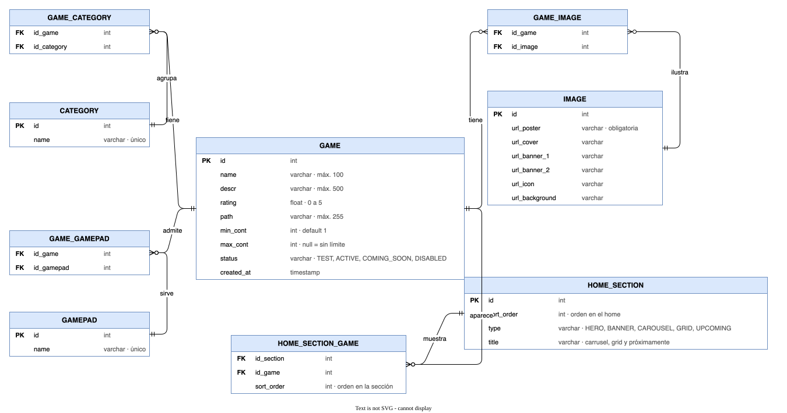

# Game Crud

API REST del catálogo de juegos sobre PostgreSQL. La usa [game-admin](../game-admin/README.md) para
crear, editar y borrar juegos y para armar la distribución del home, y
[game-client](../game-client/README.md) la lee (solo `GET`, por `/catalog/` en su nginx) para armar el home.

| | |
| --- | --- |
| Código | [`game-crud/`](../../game-crud) |
| Stack | Java 21, Spring Boot 3.4 (Web, Validation, Data JPA, Actuator) |
| Base | PostgreSQL 16, pool HikariCP |
| Documentación | OpenAPI generado por springdoc en `/v3/api-docs`, visto con Scalar en `/api-docs/` ([game-api](../../game-api/README.md)) |
| Puerto | `8096` (en el servidor solo en `127.0.0.1`) |

## Estructura

```
game-crud/
├── src/api/
│   ├── CrudApplication.java
│   ├── config/        OpenApiConfig (encabezado del OpenAPI), RequestLogFilter (una línea por petición)
│   ├── controller/    GameController (/games), CategoryController (/categories), HomeController (/home)
│   ├── service/       GameService, CategoryService, HomeService (reglas y transacciones)
│   ├── repository/    Spring Data JPA (búsqueda por nombre con SQL nativo)
│   ├── model/         Game, Category, Gamepad, Image, HomeSection (entidades JPA)
│   ├── dto/           Create/UpdateGameRequest, GameResponse, GameImages, CategoryResponse, Home*, ErrorResponse
│   └── exception/     ApiException y ApiExceptionHandler (errores JSON)
├── resources/         application.properties
├── schemas/           schema.sql + seeds (se aplican al crear el volumen de PostgreSQL)
├── compose.yaml       solo la base, para desarrollo
└── Dockerfile
```

## Modelo de datos

El esquema lo define [`schemas/schema.sql`](../../game-crud/schemas/schema.sql); Hibernate solo lo
valida al arrancar (`ddl-auto=validate`), no lo crea ni lo migra.

<p align="center"></p>

Usuarios y administradores van en tablas separadas, sin roles:

| Tabla | Quiénes | Columnas |
| --- | --- | --- |
| `AVATAR` | Avatares que eligen los jugadores (no suben los suyos): `name`, `url` (`/media/avatars/…`) y `active`. | Inactivo = no se ofrece, pero quien lo tiene lo conserva. Con la tabla vacía, game-crud carga al arrancar los de fábrica (`resources/avatars/*.jpg`). |
| `USERS` | Jugadores de game-client (`USER` es palabra reservada). La contraseña se guarda con bcrypt en `password_hash`. | `email` y `username` únicos. `id_avatar` → `AVATAR` (`ON DELETE SET NULL`: sin avatar, game-client muestra la inicial). `FRIEND` y `GAME_USER` apuntan acá. Si un usuario está jugando no se guarda en la base: lo sabe game-dispatcher (`GAME_USER` ya no tiene `status`). |
| `ADMIN` | Quienes entran a `/admin/`, `/docs/` y `/api-docs/`. | `username` único, `password_hash` (bcrypt), `created_at`. |

En bases anteriores la tabla se llamaba `APP_USER` y tenía `id_role` → `ROLE`. `schema.sql` la
renombra a `USERS` con sus filas, quita `id_role` y borra `ROLE`.

| Seed | Contenido |
| --- | --- |
| `seed_categories.sql` | Categorías base: Acción, Aventura, RPG, Estrategia, Carreras, Plataformas, Multijugador… |
| `seed_gamepads.sql` | Tipos de control: Mando, Teclado y ratón, Táctil. |
| `seed_actions.sql`, `seed_input_keyboard.sql`, `seed_input_controller.sql` | Acciones, teclas y botones (Xbox) para `GAME_INPUT`. |
| `seed_game_inputs.sql` | Controles reales de cada juego de `games/` (binds por defecto de su código o config). |

Los juegos no tienen seed: se dan de alta en game-admin (`path = /games/<gameId>`). `seed_game_inputs.sql`
busca los juegos por `path`, así que en una base nueva no inserta nada: se corre a mano después del
alta (es idempotente). Solo carga los juegos que todavía **no tienen controles**: después se editan en
game-admin (botón **Controles**) y el seed, que `deploy-loader.sh` reaplica en cada despliegue, no los
pisa. Un juego que se deja sin controles vuelve a recibir los del seed en el próximo despliegue.

```bash
docker exec -i cloudgame-loader-db-1 sh -c 'psql -v ON_ERROR_STOP=1 -U $POSTGRES_USER -d $POSTGRES_DB' \
  < game-crud/schemas/seed_game_inputs.sql
```

Imágenes: archivos locales que se suben desde game-admin (no URLs externas). game-crud los guarda en
`IMAGES_ROOT/games/<idJuego>/<tipo>-<hash>.<ext>` (volumen `catalog-images`) y en `IMAGE` queda la ruta
pública `/media/games/<idJuego>/<tipo>-<hash>.<ext>`, que sirve el propio game-crud y nginx publica en
`/media/`. Cada tipo tiene un solo archivo: subir otro borra el anterior.

Al guardarse, cada imagen se **optimiza** con ImageMagick (`ImageOptimizer`): se achica al tamaño de su
tipo sin agrandarla (póster 600×900, cover 920×430, banners y portada 1920×620, ícono 256×256) y se
pasa a WebP calidad 82. De un `.ico` se usa el cuadro más grande. Un banner 4K de SteamGridDB pasa de
6-20 MB a ~150 KB: el catálogo completo bajó de 129 MB a 10 MB y el home de ~60 MB a 5,6 MB. Si
ImageMagick falla, se guarda el original. `IMAGES_OPTIMIZE=false` lo apaga. El hash del contenido en el
nombre deja cachear un año (`immutable`): una imagen nueva es otra URL. Para buscar arte, SteamGridDB
sigue siendo la referencia de tamaños:

| Campo | Tipo en SteamGridDB | Uso en game-client |
| --- | --- | --- |
| `banner1` (Banner 1) | hero 1920×620 | Banner principal del home (`HERO`) |
| `banner2` (Banner 2) | hero 1920×620 (otro distinto al de `banner1`) | Sub banner del home (`BANNER`) |
| `poster` (Póster) | grid vertical 600×900 | Tarjeta del carrusel |
| `cover` (Cover) | grid horizontal 920×430 / 460×215 | Tarjeta del grid |
| `background` (Portada) | hero 1920×620 | Fondo de la ficha (modal) |
| `icon` (Ícono) | ícono cuadrado | Ficha y barra del reproductor |

Si falta una imagen ancha, game-client usa otra del juego (portada, banner 1, banner 2, cover, póster);
sin cover, el grid usa el póster.

**Migración.** Al arrancar, game-crud baja en segundo plano las URLs `http(s)` que queden en `IMAGE` y
reprocesa las locales que no estén en WebP; las guarda como cualquier subida (optimizadas), reemplaza la
ruta y borra el archivo viejo tras el commit (un juego por transacción). Lo que falla (formato no soportado, más de `IMAGES_MAX_MB`, red) queda con su URL y se
reintenta en el próximo arranque; con todo migrado no hace nada. `IMAGES_IMPORT_EXTERNAL=false` lo apaga.

Los archivos de `schemas/` se aplican al crear el volumen de PostgreSQL y, como son idempotentes,
`deploy-loader.sh` los reaplica en cada despliegue (ver [Despliegue](../despliegue.md)).

## API

| Método y ruta | Respuesta | Descripción |
| --- | --- | --- |
| `GET /games?status=` | `200 [GameResponse]` | Del más nuevo al más viejo. `status` (opcional, separados por coma) filtra por estado; sin él, todos (game-admin). |
| `GET /games/search?q=&status=&limit=10` | `200 [GameResponse]` | Buscador del navbar. `limit` de 1 a 50; `status` igual que en `GET /games`. |
| `GET /games/{id}` | `200 GameResponse` | Un juego con imagen, categorías y gamepads. |
| `GET /games/{id}/inputs` | `200 [GameInputResponse]` | Controles del juego: `{ action, keyboard, controller }` (null = sin ese control). Modal de controles del reproductor. |
| `PUT /games/{id}/inputs` | `200 [GameInputResponse]` | Reemplaza todos los controles (lista vacía = ninguno), en una transacción. Filas `{ action, keyboard, controller }` por nombre: la acción se crea si no existe; tecla y botón tienen que existir (`null` = sin ese control). Cada acción con tecla o botón y sin repetir; teclas solo si el juego tiene «Teclado y ratón» en sus gamepads y botones solo si tiene «Mando» (si no, `400`). Lo usa game-admin. |
| `GET /inputs` | `200 { actions, keyboard, controller }` | Nombres de acciones, teclas (y botones del ratón) y botones del mando, en el orden de los seeds y sin las filas `null`. Editor de controles de game-admin. |
| `POST /games` | `201 GameResponse` | Crea el juego y sus relaciones; las imágenes se suben después. |
| `PATCH /games/{id}` | `200 GameResponse` | Cambia solo los campos enviados. |
| `PUT /games/{id}/images/{tipo}` | `200 GameResponse` | Sube o reemplaza una imagen (`poster`, `cover`, `banner1`, `banner2`, `icon`, `background`). Cuerpo: el archivo, con `Content-Type: image/*` o `application/octet-stream`. PNG, JPEG, WebP, GIF o ICO (se detecta por el contenido), hasta `IMAGES_MAX_MB`. El archivo anterior se borra al confirmar. |
| `DELETE /games/{id}/images/{tipo}` | `200 GameResponse` | Quita una imagen opcional y su archivo. El póster solo se reemplaza (`400`). |
| `GET /media/games/{id}/{archivo}` | `200` imagen | Archivos de `IMAGES_ROOT`, con `Cache-Control: max-age=31536000, immutable`. |
| `DELETE /games/{id}` | `204` | Borra el juego y su imagen. |
| `GET /categories` | `200 [CategoryResponse]` | Todas, ordenadas por nombre. |
| `GET /categories/{id}/games` | `200 [GameResponse]` | Juegos de una categoría. |
| `GET /home` | `200 HomeResponse` | Distribución del home: secciones en orden con sus juegos. |
| `PUT /home` | `200 HomeResponse` | Reemplaza toda la distribución (game-admin, pestaña **Home**). |
| `GET /users/by-email?email=` | `200 UserResponse` | Usuario por email (sin distinguir mayúsculas); `404` = primera vez, hay que pedir el username. |
| `POST /users` | `201 UserResponse` | Registra `{ email, username, avatarId }` (`avatarId` opcional: sin él, el primer avatar activo). `UserResponse` es `{ id, email, username, avatarId, avatar }`. `409` si el email o el username ya existen. |
| `POST /auth/register` | `201 { token, user }` | Crea la cuenta: `{ email, password, username, avatarId? }`. La contraseña debe tener al menos 8 caracteres (máx. 72 bytes) y se guarda con bcrypt. `409` si el correo o el username ya existen; `400` si los datos son inválidos. |
| `POST /auth/login` | `200 { token, user }` | `{ email, password }`. `401 INVALID_CREDENTIALS` si no coinciden (misma respuesta y mismo tiempo si el correo no existe). Ver [Sesión y saves](#sesión-y-saves). |
| `GET /auth/me` | `200 UserResponse` | Usuario del `Authorization: Bearer <token>`. `401` si venció. |
| `PUT /auth/me/avatar` | `200 UserResponse` | El jugador elige `{ avatarId }` entre los activos. `400` si no existe o está inactivo. Bearer. |
| `GET /avatars` | `200 [AvatarResponse]` | Avatares activos `{ id, name, url, active }`, por id (lo que ofrece game-client). `?all=true` incluye los inactivos (game-admin). |
| `POST /avatars?name=` | `201 AvatarResponse` | Crea un avatar. Cuerpo: la imagen, como en `PUT /games/{id}/images/{tipo}`. Se achica a 512×512 y pasa a WebP en `/media/avatars/`. |
| `PATCH /avatars/{id}` | `200 AvatarResponse` | Cambia `{ name, active }` (solo los enviados). |
| `PUT /avatars/{id}/image` | `200 AvatarResponse` | Reemplaza la imagen; quien lo tiene ve la nueva y el archivo anterior se borra. |
| `DELETE /avatars/{id}` | `204` | Borra el avatar y su archivo; los jugadores que lo tenían quedan sin avatar. |
| `GET /friends` | `200 [FriendPlayingResponse]` | Todos los amigos (`FRIEND` `ACCEPTED`, en cualquier dirección): primero los que están en partida (como `/friends/playing`) y después el resto por username con `game` y `since` en `null`. Si game-dispatcher no responde, todos salen sin juego (no da `502`). Bearer. |
| `GET /friends/playing` | `200 [FriendPlayingResponse]` | Amigos (`FRIEND` `ACCEPTED`, en cualquier dirección) en partida: `{ userId, username, game { id, name, icon }, since }`, el más reciente primero. Bearer del jugador. El estado lo responde game-dispatcher (`GET /players/playing`, con `DISPATCHER_URL` y `DISPATCHER_API_TOKEN`); `502 DISPATCHER_UNAVAILABLE` si no responde. |
| `GET /friends/events` | `200 text/event-stream` | Cambios en vivo del jugador (Bearer), sin consultar cada tanto: `friend` (un amigo empezó o dejó de jugar, con su `FriendPlayingResponse`), `friends` (cambió la lista), `requests` (cambió la bandeja) y `resync` (recargar todo). Ping cada 25 s. game-crud escucha `GET /players/events` del dispatcher con una sola conexión y solo avisa a amigos con el stream abierto. |
| `GET /friends/requests` | `200 [FriendRequestResponse]` | Bandeja de entrada: solicitudes `PENDING` recibidas `{ id, userId, username }`, la más nueva primero. Bearer. |
| `POST /friends/requests` | `201 FriendSearchResponse` | Envía `{ userId }`. Si el otro ya le había enviado una pendiente, se acepta (`relation: FRIEND`). `409` si ya son amigos o ya se envió (también si la rechazaron: al emisor no se le avisa). Bearer. |
| `POST /friends/requests/{id}/accept` | `204` | Acepta una solicitud pendiente recibida. `404` si no es del jugador o ya se respondió. Bearer. |
| `POST /friends/requests/{id}/reject` | `204` | Rechaza una solicitud pendiente recibida. Quien la rechaza puede enviar después una propia. Bearer. |
| `GET /friends/search?q=&limit=10` | `200 [FriendSearchResponse]` | Jugadores cuyo username contiene `q` (sin mayúsculas ni tildes), sin el propio: `{ userId, username, relation, requestId }` con `relation` `NONE`, `SENT`, `RECEIVED` (con `requestId`) o `FRIEND`. `limit` de 1 a 20. Bearer. |
| `GET /saves/{gameId}` | `200 application/gzip` | Save del jugador (solo estaciones, por loopback). `404` = todavía no hay. |
| `PUT /saves/{gameId}` | `204` | Reemplaza el save (cuerpo `application/gzip`). `413` si supera `SAVES_MAX_MB`. |
| `GET /admins` | `200 [AdminResponse]` | Administradores `{ id, username, createdAt }`, por username. |
| `POST /admins` | `201 AdminResponse` | Crea `{ username, password }`. `username`: 3 a 50 de `A-Z a-z 0-9 . _ -`; `password`: 8 a 72. `409` si el username existe. |
| `PUT /admins/{id}/password` | `204` | Cambia la contraseña `{ password }`. |
| `DELETE /admins/{id}` | `204` | Borra. `409` si es el último. |
| `GET /admins/verify` | `204` / `401` | Valida el header `Authorization: Basic …`. Lo llama nginx (`auth_request`); el `401` trae `WWW-Authenticate`. |
| `GET /health` | `200` | Actuator, incluye el chequeo de la base. |

Referencia completa con esquemas y "Probar": `https://<PUBLIC_HOST>/api-docs/` → *Catálogo (game-crud)*.

**Juego (`GameResponse`):**

```json
{
  "id": 7,
  "name": "SuperTuxKart",
  "description": "Carreras de karts con personajes de software libre",
  "rating": 4.5,
  "path": "/games/supertuxkart",
  "minContainers": 1,
  "maxContainers": 4,
  "status": "ACTIVE",
  "images": { "poster": "/media/games/7/poster-3fa1c2d4e5b6a798.png", "cover": null, "banner1": null, "banner2": null, "icon": null, "background": null },
  "categories": ["Carreras", "Multijugador"],
  "gamepads": ["Mando", "Teclado y ratón"],
  "createdAt": "2026-09-30T12:00:00"
}
```

`images` es `null` si el juego todavía no tiene ninguna imagen (recién creado). Categorías y gamepads van por nombre, ordenados.

### Reglas

- **Transacciones.** Crear, editar y borrar ocurren en una sola transacción: si algo falla, no queda nada a medias.
- **Categorías y gamepads por nombre.** Se buscan por `name` y se crean si no existen. Se ignoran vacíos y repetidos.
- **`PATCH` parcial.** Un campo ausente no cambia. `description: ""` la borra; `rating: null` y `maxContainers: null` los borran. `categories` y `gamepads` se reemplazan enteros. `POST` y `PATCH` ya no reciben `images`: se ignora.
- **Estado (`status`).** `ACTIVE` si no se envía (y en los juegos que ya existían).
  - `TEST`: de prueba; game-client solo lo muestra en desarrollo (`npm run dev` o `VITE_SHOW_TEST_GAMES=true`).
  - `ACTIVE`: visible y jugable.
  - `COMING_SOON`: visible como «Próximamente» (tarjetas atenuadas, botón Jugar deshabilitado); el dispatcher rechaza la partida (`409 GAME_UNAVAILABLE`) y no le precalienta estaciones.
  - `DISABLED`: no le llega a game-client (ni en el juego aleatorio, ni en el buscador, ni en el home); el dispatcher también la rechaza.

  game-client pide `GET /games?status=ACTIVE,COMING_SOON` (más `TEST` en desarrollo) y filtra igual los juegos de `GET /home`.
- **Contenedores.** `minContainers` vale 1 si no se envía; `maxContainers` no puede ser menor (`400`).
- **Imágenes.** Una por tipo. Al subir, el archivo nuevo se escribe antes de la transacción: si la transacción falla se borra el nuevo, y si se confirma se borra el anterior. No quedan huérfanos.
- **Borrado.** Se borran el juego, su fila de `IMAGE`, sus vínculos y su carpeta de imágenes; las categorías y gamepads siguen existiendo.
- **Búsqueda.** "Contiene", sin distinguir mayúsculas ni tildes (`acción` = `accion`); primero los que empiezan por el texto, luego por nombre. `%` y `_` se buscan literalmente. Con `q` vacío no filtra.

### Home

`GET /home` devuelve `{ "sections": [{ "id", "type", "title", "games": [GameResponse] }] }` en el orden
en que game-client las muestra; `PUT /home` recibe `{ "sections": [{ "type", "title", "gameIds" }] }`
y reemplaza todo en una transacción.

| `type` | En game-client | Juegos | `title` |
| --- | --- | --- | --- |
| `HERO` | Banner principal, con el header. Como mucho uno y **primero**. | Exactamente 1 | Se ignora |
| `BANNER` | Sub banner (variante *highlight*). Puede haber varios. | Exactamente 1 | Se ignora |
| `CAROUSEL` | Carrusel de tarjetas verticales (`poster`). | Al menos 1, en orden | Título del carrusel |
| `GRID` | Grid con filtro por género. Nunca muestra juegos `COMING_SOON`. | En orden; vacío = todo el catálogo por título | Título del grid |
| `UPCOMING` | Carrusel de próximos lanzamientos. | Ninguno al guardar (`400` si se envían); `GET /home` trae los `COMING_SOON`, del más nuevo al más viejo | Título del carrusel |

- El banner principal usa `banner1` y el sub banner `banner2` (si faltan, otra imagen ancha del juego), más su nombre, géneros y descripción.
- Un juego no puede repetirse dentro de una sección, pero sí aparecer en varias.
- Borrar un juego lo saca de las secciones (`ON DELETE CASCADE`); game-client no muestra un banner o
  carrusel que quedó sin juegos.
- `sections: []` (o nunca haber guardado) = sin configurar: game-client usa su home por defecto.
- Máximo 30 secciones. Un `gameId` que no existe es `400`.

### Administradores

nginx (game-client) protege `/admin/`, `/docs/` y `/api-docs/` con `auth_request` a
`GET /admins/verify`, que compara el basic auth contra `ADMIN` con bcrypt. Como una página trae
muchos archivos, un header ya validado se recuerda 60 s en memoria (solo su SHA-256). Crear, borrar
o cambiar una contraseña vacía ese cache. `/admins` no se publica: se llega desde game-admin
(`/admin/api/admins`, detrás del mismo login).

### Sesión y saves

Los jugadores pueden jugar sin sesión (anónimos), pero entonces la estación borra su progreso al
salir. Con sesión, el progreso se guarda en el servidor y se recupera en cualquier estación o
dispositivo.

1. **Registro y login.** `POST /auth/register { email, password, username, avatarId? }` crea la
   cuenta (contraseña de 8 caracteres como mínimo, guardada con bcrypt en `USERS.password_hash`) y
   devuelve la sesión. `POST /auth/login { email, password }` la valida contra ese hash. En ambos casos
   game-crud firma su propio token (JWT HS256 con `CLOUDGAME_JWT_SECRET`, `typ=user`, 30 días).
2. **Partida.** El cliente manda el token al dispatcher (`Authorization: Bearer`). El dispatcher, que
   comparte el secreto, devuelve en la sesión un `saveGrant` (`typ=save`, con `uid` y `game`, 24 h).
3. **Estación.** En `POST /launch` recibe el `saveGrant`, baja `GET /saves/{gameId}` y lo extrae antes de
   arrancar el juego. En `stop` empaqueta el progreso y hace `PUT /saves/{gameId}`.

Los archivos van en `SAVES_ROOT/<userId>/<gameId>.tar.gz` (volumen `player-saves`), con una fila en
`SAVE_GAME (id_user, game_id, size_bytes, updated_at)`. Se escriben a un temporal y se renombran, así
un corte a mitad deja el save anterior. Hay una sola copia por usuario y juego, sin historial.
`/saves` valida que el permiso sea del mismo juego que la ruta (`403` si no) y nginx no lo publica.

Sin `CLOUDGAME_JWT_SECRET`, `/auth` y `/saves` responden `503 AUTH_DISABLED` y el resto del catálogo
sigue funcionando.

### Errores

Mismo formato que la estación y el loader: `{ "error": { "code", "message" } }`.

| Código | HTTP | Cuándo |
| --- | --- | --- |
| `BAD_REQUEST` | 400 | Validación (el mensaje nombra el campo, p. ej. `name: no debe estar vacío`), tipo de imagen inválido, quitar el póster, JSON inválido, `id` o `limit` fuera de rango. |
| `NOT_FOUND` | 404 | No existe el juego, la categoría, el usuario o el administrador. |
| `CONFLICT` | 409 | Email o username de usuario repetido, username de administrador repetido, o borrar al último administrador. |
| `INVALID_CREDENTIALS` / `UNAUTHORIZED` | 401 | Correo o contraseña incorrectos / token o permiso de save inválido o vencido. |
| `FORBIDDEN` | 403 | Permiso de save de otro juego. |
| `SAVE_TOO_LARGE` | 413 | El save supera `SAVES_MAX_MB`. |
| `IMAGE_TOO_LARGE` | 413 | La imagen supera `IMAGES_MAX_MB`. |
| `UNSUPPORTED_IMAGE` | 415 | El archivo no es PNG, JPEG, WebP, GIF ni ICO (SVG no se acepta). |
| `UNSUPPORTED_MEDIA_TYPE` | 415 | La subida no vino con `Content-Type: image/*` ni `application/octet-stream`. |
| `AUTH_DISABLED` | 503 | Falta `CLOUDGAME_JWT_SECRET`. |
| `CONSTRAINT_VIOLATION` | 409 | Un `CHECK`, `NOT NULL` o `UNIQUE` de la base que la validación no atrapó. |
| `DATABASE_UNAVAILABLE` | 503 | Sin conexión a PostgreSQL (o se cortó a mitad de la petición). |
| `INTERNAL_ERROR` | 500 | Cualquier otra excepción (queda en el log). |

## Configuración

`application.properties` lee variables de entorno y, en desarrollo, un `.env` en `game-crud/`
(plantilla: `.env.example`). Una variable de entorno real tiene prioridad sobre el archivo.

| Variable | Default | Uso |
| --- | --- | --- |
| `DB_HOST` / `DB_PORT` / `DB_NAME` | — | Conexión a PostgreSQL (`5433` en el compose). |
| `DB_USER` / `DB_PASSWORD` | — | Credenciales. |
| `DB_POOL_MAX_SIZE` | `10` | Conexiones máximas de HikariCP. |
| `DB_POOL_TIMEOUT_MS` | `5000` | Espera por una conexión antes de fallar (`503`). |
| `SERVER_PORT` | `8096` | Puerto HTTP. |
| `SERVER_ADDRESS` | todas | En el servidor `127.0.0.1`. |
| `API_DOCS_ENABLED` | `true` | Publica `/v3/api-docs` (lo lee Scalar). |
| `ADMIN_USER` / `ADMIN_PASSWORD` | `admin` / vacío | Primer administrador: se crea al arrancar solo si `ADMIN` está vacía. Después no se usan. |
| `CLOUDGAME_JWT_SECRET` | vacío | Secreto de los tokens de jugador y permisos de save (el mismo en game-dispatcher, mín. 32 caracteres). Vacío = sin sesión. |
| `CLOUDGAME_USER_TOKEN_TTL_DAYS` | `30` | Vida del token de sesión. |
| `SAVES_ROOT` | `/var/lib/cloudgame/saves` | Carpeta de los saves (en compose, volumen `player-saves`). |
| `SAVES_MAX_MB` | `256` | Tope de un save. |
| `IMAGES_ROOT` | `/var/lib/cloudgame/images` | Carpeta de las imágenes del catálogo (en compose, volumen `catalog-images`; en desarrollo, p. ej. `/tmp/cloudgame-images`). |
| `IMAGES_MAX_MB` | `25` | Tope de una imagen (nginx acepta hasta 32 MB en `/admin/`). |
| `IMAGES_IMPORT_EXTERNAL` | `true` | Al arrancar, baja las URLs externas que queden en `IMAGE` y optimiza las locales que no estén en WebP. |
| `IMAGES_OPTIMIZE` | `true` | Achica cada imagen al tamaño de su tipo y la pasa a WebP (ImageMagick, incluido en la imagen Docker). |

## Desarrollo local

```bash
cd game-crud
cp .env.example .env
docker compose up -d            # PostgreSQL en :5433 con schemas/ aplicados
export JAVA_HOME=$(/usr/libexec/java_home -v 21)
mvn spring-boot:run             # http://127.0.0.1:8096/games
```

Para verlo desde el panel: `cd game-admin && npm run dev` (su proxy de Vite reenvía `/api` a `:8096`).

## Despliegue

En `compose.loader.yaml` corren `db` (PostgreSQL 16, volumen `db-data`, solo en loopback) y
`game-crud` (host network, `127.0.0.1:8096`). No se abre al firewall: se llega por el nginx de
game-client en `/admin/api/` y por la documentación en `/api-docs/`, ambos con el login del admin, y
en `/catalog/` sin login pero solo `GET /games…`, `GET /categories…`, `GET /home` (el home del cliente) y `GET /avatars`.
`deploy-loader.sh` genera `DB_PASSWORD` la primera vez. Detalle en [Despliegue](../despliegue.md).

El CI compila el módulo (`mvn -B package`) en cada push.
