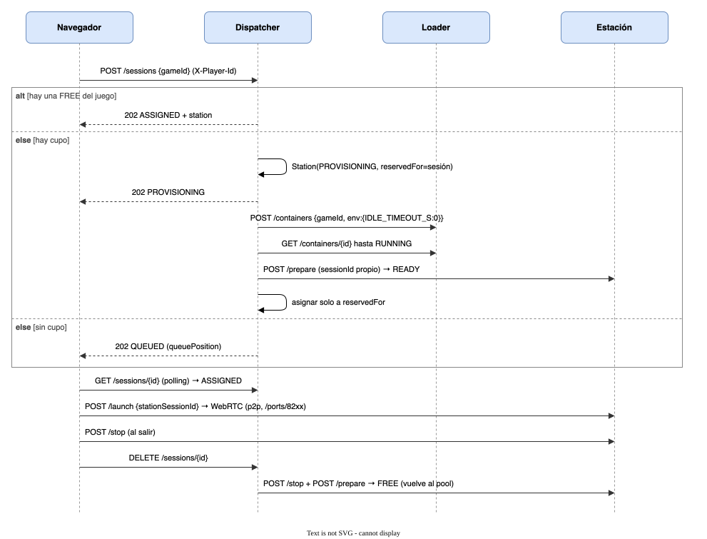

# Game Dispatcher

El **Game Dispatcher** es el servicio del *GameManager* por el que pasan todas las solicitudes de partida. Ante cada pedido:

- reutiliza una estación libre del juego, o le pide al **Game Loader** una nueva, reservada para el jugador que la pidió;
- encola la solicitud si no hay cupo;
- mantiene el mínimo de estaciones listas por juego;
- libera las estaciones inactivas y destruye las libres que sobran.

| | |
| --- | --- |
| Código | [`game-dispatcher/`](../../game-dispatcher) |
| Lenguaje / framework | Java 21, Spring Boot 3.4.5 |
| Puerto | `8094` (solo en loopback dentro de `compose.loader.yaml`) |
| Estado | En memoria. Al arrancar se reconstruye desde el loader (`GET /containers`) y el `/health` de cada estación. |
| Habla con | loader (`:8095`, Bearer `LOADER_API_TOKEN`), game-crud (`:8096`, `GET /games`), estaciones (`:82xx`) |
| API | [`game-api/openapi/game-dispatcher.yaml`](../../game-api/openapi/game-dispatcher.yaml) · Scalar en `/api-docs/` |

## 1. Flujo de una partida

<p align="center"></p>

El dispatcher no participa del signaling. El browser negocia WebRTC directo con la estación, por `stationBase` (`/ports/<httpPort>` detrás del nginx del cliente). El dispatcher solo asigna la estación y la deja en `READY` con un `stationSessionId`, para que el cliente lance sin hacer `prepare`.

## 2. API

### Pública (browser, vía `/dispatcher/` del nginx)

Cada ruta identifica al jugador de una de estas dos formas:

- **Con sesión:** `Authorization: Bearer <token de game-crud>` (ver [Sesión y saves](../game-crud/README.md#sesión-y-saves)). El jugador es el usuario (`user-<id>`), así que tiene una sola sesión activa en todos sus dispositivos. El `X-Player-Id` sigue identificando el dispositivo: solo el que abrió la partida la juega y la libera. Si otro dispositivo pide el mismo juego recibe `409 PLAYING_ELSEWHERE`, y su `DELETE` no la termina. Si el primero se desconecta sin liberar, la regla `DISCONNECTED` la cierra y el otro ya puede jugar. Cuando la sesión tiene estación, trae `saveGrant`: el permiso que la estación usa para bajar y subir el progreso en game-crud. Un token inválido o vencido responde `401 UNAUTHORIZED`.
- **Anónimo:** header `X-Player-Id`, un UUID que el cliente guarda en `localStorage` ([`player.ts`](../../game-client/src/services/player.ts)). Sin `saveGrant`: la estación borra el progreso al terminar.

Cada player solo ve y libera sus propias sesiones.

| Método y ruta | Respuesta |
| --- | --- |
| `POST /sessions {gameId}` | **202** `Session`. Es idempotente por player, dispositivo y juego; desde otro dispositivo del mismo usuario es `409 PLAYING_ELSEWHERE`. Si el player tiene activa una sesión de otro juego, la termina (`REPLACED`). |
| `GET /sessions/{id}` | `Session`. Responde `404 SESSION_NOT_FOUND` si la sesión no existe o es de otro player. |
| `DELETE /sessions/{id}` | **204**, idempotente. Desde otro dispositivo del mismo usuario no la termina. La estación se recicla, no se destruye. |

```json
{
  "sessionId": "0b6f…",
  "gameId": "supertuxkart",
  "status": "ASSIGNED",
  "queuePosition": null,
  "station": { "stationBase": "/ports/8201", "stationSessionId": "9c1e…", "httpPort": 8201 },
  "endReason": null,
  "createdAt": "2026-10-01T14:00:00Z"
}
```

`status` toma estos valores:

- `QUEUED`: sin cupo; `queuePosition` indica la posición (1 = siguiente).
- `PROVISIONING`: está esperando una estación reservada para la sesión.
- `ASSIGNED`: ya tiene estación, pero el cliente todavía no lanzó.
- `PLAYING`: la estación está en `PLAYING`.
- `ENDED` / `FAILED`: estados terminales; el motivo va en `endReason`.

`endReason` toma estos valores:

| `endReason` | Cuándo |
| --- | --- |
| `RELEASED` | El cliente hizo `DELETE` (salió del juego o cerró la pestaña). |
| `REPLACED` | El mismo player pidió otro juego. |
| `INACTIVITY` | Pasó `DISPATCHER_INACTIVITY_TIMEOUT_S` sin input. |
| `DISCONNECTED` | Pasó `DISPATCHER_DISCONNECT_GRACE_S` sin socket WebRTC (pestaña muerta sin `pagehide`). |
| `CLAIM_TIMEOUT` | La estación estuvo `DISPATCHER_CLAIM_TIMEOUT_S` asignada sin `PLAYING`. |
| `STATION_LOST` | El `/health` de la estación dejó de responder (`FAILED`). |
| `PROVISION_FAILED` | No se pudo crear o preparar la estación reservada (`FAILED`). |

### Admin (Bearer `DISPATCHER_API_TOKEN`)

| Método y ruta | Respuesta |
| --- | --- |
| `GET /health` | `{status, ready, capacity, stations, queued}` (sin auth). |
| `GET /stations?gameId=&inUse=` | Contenedores vivos, clasificados por **juego** (`gameId`) y por **uso** (`inUse`). Cada uno trae `state`, `sessionId`, `playerId`, `httpPort` y `since`. |
| `GET /pool` | Por juego: `minContainers`, `maxContainers`, `total`, `free`, `inUse`, `provisioning`, `queued`. |
| `GET /players/playing?userIds=2,3` | De esos usuarios (ids de `USERS`, máximo 500), los que tienen sesión `PLAYING`: `{ userId, gameId, since }`. Lo usa game-crud para `GET /friends/playing`. |
| `GET /players/events` | SSE: evento `playing` con `{ userId, gameId, since }` cada vez que un usuario con sesión entra o sale de `PLAYING` (`gameId` y `since` en `null` = dejó de jugar); ping cada 25 s. game-crud mantiene una sola conexión y reparte los cambios a los amigos conectados. |

Errores: `{ "error": { "code", "message" } }`. Códigos: `BAD_REQUEST` 400, `GAME_NOT_FOUND` 404, `GAME_UNAVAILABLE` 409 (el juego está `COMING_SOON` o `DISABLED` en game-crud), `SESSION_NOT_FOUND` 404, `UNAUTHORIZED` 401, `CATALOG_UNAVAILABLE` 503 (todavía arrancando).

## 3. Estados de una estación

| Estado | Significado |
| --- | --- |
| `PROVISIONING` | El loader la está creando. Termina con la estación en `READY`. |
| `WARMING` | Se recicla tras una partida (`/stop` + `/prepare`). Si no contesta `/health` en `DISPATCHER_HEALTH_FAILURES × DISPATCHER_POLL_INTERVAL_MS` (no espera el provision-timeout) se da por colgada, se borra y la sesión que la tenía reservada vuelve al frente de la cola. |
| `FREE` | Está en `READY` y lista para asignar. |
| `ASSIGNED` | Está entregada a una sesión, pero el cliente todavía no lanzó. |
| `IN_USE` | La estación está en `PLAYING`. |
| `DRAINING` | Se está borrando en el loader. |

`inUse` es `true` en `ASSIGNED` e `IN_USE`.

## 4. Reglas

### Asignación y anti-carrera

Cada solicitud se decide bajo un único lock del dispatcher, en este orden:

1. Si hay una estación **`FREE`** del juego, se asigna.
2. Si hay una **en camino** (`PROVISIONING`/`WARMING`) del juego que no está reservada, se reserva para esta sesión.
3. Si hay **cupo** (`total(juego) < maxContainers` y quedan slots del loader), se registra una estación `PROVISIONING` con `reservedFor = sessionId` *antes* de llamar al loader. El slot queda contado desde ese momento, y la estación, cuando queda lista, se entrega **solo** a esa sesión. El pool nunca reparte una estación reservada, así que dos jugadores que piden a la vez reciben cada uno la suya.
4. Si hay una **libre de otro juego** cuyo juego queda por encima de su mínimo, se desaloja (`DRAINING`) y su slot pasa a la nueva estación reservada.
5. Si no se cumple nada de lo anterior, la sesión queda **`QUEUED`**.

**Cola FIFO.** Cada vez que una estación queda libre o se libera un slot, la cola se recorre en orden:

- La primera solicitud que necesita crear y no consigue slot bloquea la creación para las que vienen detrás.
- Las que vienen detrás igual pueden tomar una estación libre (o en camino) de su propio juego.
- Mientras haya cola, no se repone el pool.

### Inactividad (cada `DISPATCHER_POLL_INTERVAL_MS`)

El dispatcher consulta `/health` de cada estación libre o asignada. Desde la estación lee `state`, `lastInputAt`, `playingSince` y `peerConnected`.

- **`ASSIGNED`:** si la estación pasa a `PLAYING`, queda `IN_USE`. Si no lo hace en `DISPATCHER_CLAIM_TIMEOUT_S`, se libera (`CLAIM_TIMEOUT`).
- **`IN_USE`:**
  - Sin input (`lastInputAt`, o `playingSince` si no hubo input) por más de `DISPATCHER_INACTIVITY_TIMEOUT_S`: se libera (`INACTIVITY`). Cuenta como input un control presionado o un movimiento; los datagramas en reposo, no.
  - Si la estación no reporta `playingSince` (imagen anterior al dispatcher), no se aplica la regla de inactividad y el log avisa que hay que reconstruir la imagen.
  - Sin peer WebRTC por más de `DISPATCHER_DISCONNECT_GRACE_S`: se libera (`DISCONNECTED`).
  - Si la estación vuelve a `IDLE`/`READY` porque el cliente hizo `/stop`, vuelve a `ASSIGNED` y corre de nuevo el claim timeout.
- **`FREE`:** si alguien la tocó por fuera (no está `READY` con su `stationSessionId`), se recicla.
- **Cualquier estado:** si `/health` falla `DISPATCHER_HEALTH_FAILURES` veces seguidas, se destruye y la sesión queda `FAILED` (`STATION_LOST`).

Para que el dispatcher sea el único que decide, cada estación se crea con `IDLE_TIMEOUT_S=0`, lo que apaga el timer propio de la estación.

### Pool mínimo y TTL de libres (cada `DISPATCHER_POOL_INTERVAL_MS`)

- **Mínimo:** `minContainers` de cada juego del catálogo (game-crud, editable en game-admin) es la cantidad de estaciones **listas** (libres o por quedar libres sin reserva) que siempre tiene que haber. Si faltan, se piden al loader, respetando `maxContainers` y la capacidad. Solo cuenta para juegos `ACTIVE`: los `TEST` se crean a pedido y los `COMING_SOON` / `DISABLED` no se asignan.
- **TTL:** una estación `FREE` por más de `DISPATCHER_FREE_TTL_S` se destruye, pero **solo** si el juego queda por encima de su mínimo.
- **Capacidad insuficiente:** si la suma de los mínimos supera `LOADER_MAX_CONTAINERS`, se llenan en el orden del catálogo y se escribe un `WARN` (`pool game=… short by N`). Hoy `min_cont` vale 1 por defecto en la base, así que conviene revisar los mínimos en game-admin o desactivar el pool con `DISPATCHER_WARM_POOL=false`.
- **Catálogo:** se relee cada `DISPATCHER_CATALOG_REFRESH_S`. Un juego del crud sin imagen en el loader (`GET /images`) se ignora.

### Arranque

1. Espera al loader, con backoff de hasta 30 s. Mientras tanto, `POST /sessions` responde `503 CATALOG_UNAVAILABLE`.
2. Adopta los contenedores existentes:
   - `EXITED`/`UNHEALTHY`: se borran.
   - `PLAYING`: pasan a `IN_USE` sin dueño; los liberan las reglas de inactividad.
   - `READY`: pasan a `FREE`.
   - El resto se recicla.
3. Pide al loader los mínimos de cada juego.

Las sesiones no sobreviven a un reinicio del dispatcher. Un cliente con una sesión vieja recibe `404 SESSION_NOT_FOUND` y vuelve a pedir partida.

## 5. Configuración

| Variable | Default | |
| --- | --- | --- |
| `DISPATCHER_HTTP_PORT` | `8094` | |
| `DISPATCHER_API_TOKEN` | vacío | Bearer de `/stations`, `/pool` y `/players` (game-crud también lo usa). Vacío = sin auth (solo desarrollo). `deploy-loader.sh` lo genera. |
| `LOADER_URL` / `LOADER_API_TOKEN` | `http://127.0.0.1:8095` / vacío | |
| `CRUD_URL` | `http://127.0.0.1:8096` | |
| `STATION_HOST` | `127.0.0.1` | Host con el que el dispatcher llega a las estaciones (host network). |
| `DISPATCHER_STATIONS_URL` | `/ports` | Prefijo de `stationBase`. Vacío = `http://<STATION_HOST>:<puerto>` (desarrollo sin nginx). |
| `DISPATCHER_WARM_POOL` | `true` | `false` = no crea por adelantado (ignora `minContainers`). |
| `CLOUDGAME_JWT_SECRET` | vacío | Mismo secreto que game-crud: verifica tokens de jugador y firma `saveGrant`. Vacío = solo anónimos (`503 AUTH_DISABLED` si llega un Bearer). |
| `DISPATCHER_SAVE_GRANT_TTL_H` | `24` | Vida del `saveGrant`. Tiene que cubrir la partida más larga, porque se usa al hacer stop. |
| `DISPATCHER_SAVES_URL` | `http://127.0.0.1:8096` | game-crud visto desde las estaciones. Se pasa a cada estación como `SAVES_URL`. |
| `DISPATCHER_INACTIVITY_TIMEOUT_S` | `300` | |
| `DISPATCHER_FREE_TTL_S` | `600` | |
| `DISPATCHER_CLAIM_TIMEOUT_S` | `60` | |
| `DISPATCHER_DISCONNECT_GRACE_S` | `30` | |
| `DISPATCHER_PROVISION_TIMEOUT_S` | `180` | Tope para crear o reciclar una estación y dejarla en `READY`. |
| `DISPATCHER_HEALTH_FAILURES` | `5` | |
| `DISPATCHER_POLL_INTERVAL_MS` / `DISPATCHER_POOL_INTERVAL_MS` | `2000` / `10000` | |
| `DISPATCHER_CATALOG_REFRESH_S` | `60` | |
| `DISPATCHER_PREPARE_VERSION` | `1.0.0` | `version` del `prepare` (`/library/<gameId>/<version>`). |

## 6. Despliegue y desarrollo

En el servidor ya forma parte de `compose.loader.yaml` (`./scripts/deploy-loader.sh`). El nginx del cliente expone solo `POST /dispatcher/sessions` y `GET·DELETE /dispatcher/sessions/{id}`. El loader ya no es accesible desde el browser.

**Mac** (Docker Desktop con host networking, sin uinput):

```bash
export JAVA_HOME=$(/usr/libexec/java_home -v 21)
./scripts/build-station.sh supertuxkart
(cd game-loader && DOCKER_HOST=unix://$HOME/.docker/run/docker.sock LOADER_UINPUT=false mvn spring-boot:run)
(cd game-crud && docker compose up -d && mvn spring-boot:run)          # catálogo con min_cont
(cd game-dispatcher && DISPATCHER_STATIONS_URL= mvn spring-boot:run)   # stationBase directo a 127.0.0.1:82xx
(cd game-client && VITE_DISPATCHER_URL=/dispatcher npm run dev)        # vite hace de proxy a :8094
```

Para ver el estado del pool: `curl :8094/pool` y `curl ':8094/stations?inUse=true'` (en desarrollo sin token).

## 7. Pruebas

`mvn test` en `game-dispatcher/`. Usa fakes del loader, de las estaciones y del catálogo (`src/test/.../fake`) y un reloj manual para los timeouts. Cubre:

- reutilizar una libre;
- dos solicitudes simultáneas que reciben cada una su estación reservada;
- la cola FIFO y el desalojo de otro juego (pero no por debajo de su mínimo);
- el TTL con mínimo;
- claim, desconexión e inactividad;
- la estación caída;
- la adopción al arrancar;
- el contrato HTTP.

## 8. Pendiente

- **Un solo host:** el dispatcher habla con un único loader.
- **Identidad anónima:** el `X-Player-Id` lo genera el browser y no prueba quién es el jugador. Cuando exista login (`USERS` en game-crud), el player id pasa a salir del token.
- **`/ports/82xx` sigue siendo alcanzable** por cualquiera que conozca el puerto. Si alguien toca una estación libre, el dispatcher la recicla, pero no lo impide.
- **Historial:** no hay historial de partidas (el dispatcher no tiene DB).
