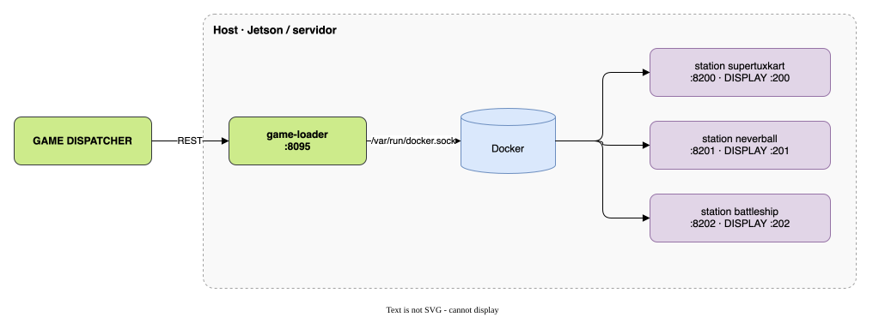
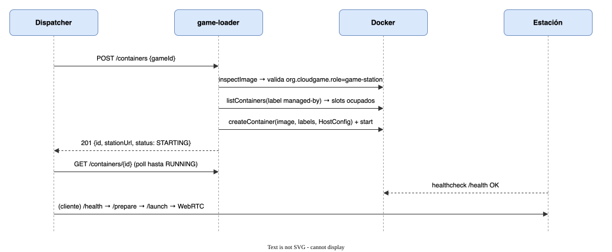

# Game Loader

Guía de implementación del **Game Loader**. Es un único servicio del *GameManager* que administra los
contenedores de estación de su host: **crea**, **destruye**, **lista** y **muestra los logs** de N
contenedores. Cada contenedor ejecuta **un solo juego** (`cloudgame/game-station-<gameId>`).

> **Estado:** implementado en [`game-loader/`](../../game-loader) (F1 + F2 + Dockerfile, compose, CI y proxy `/ports`).
> Es el modo de despliegue por defecto (`./scripts/deploy-loader.sh`).
> Lo usa el Game Dispatcher, que reparte y recicla las estaciones (§7.5).

| | |
| --- | --- |
| Código | [`game-loader/`](../../game-loader) |
| Lenguaje | Java 21 |
| Framework | Spring Boot 3.4.5, igual que [`game-station/pom.xml`](../../game-station/pom.xml) |
| Docker | [`docker-java`](https://github.com/docker-java/docker-java) 3.4.x, contra `/var/run/docker.sock` |
| Puerto | `8095` |
| Estado | Sin base de datos: se reconstruye desde Docker con labels `org.cloudgame.*` |

## 1. Alcance

**Qué hace**

- Crea un contenedor de estación (`cloudgame/game-station-<gameId>`) en el host, siempre que quede un slot libre.
- Destruye contenedores. La operación es idempotente.
- Lista los contenedores, con filtros por juego o estado.
- Devuelve los logs de un contenedor, ya sea las últimas N líneas o un stream en vivo por SSE.
- Informa qué imágenes de juego hay en el host.

**Qué no hace (por ahora)**

- **Asignar jugadores.** Es tarea del Game Dispatcher: el Dispatcher pide contenedores al loader y entrega
  la `stationUrl` al cliente.
- **Manejar la partida.** El ciclo `prepare → launch → stop` sigue siendo de la estación
  ([`docs/game-station/api.md`](../game-station/api.md)). El loader maneja el **contenedor**, no la FSM
  `IDLE/READY/PLAYING`.
- **Construir imágenes.** Siguen saliendo de `scripts/build-station.sh <game>`.
- **Descargar desde Storage** (la flecha `STORAGE → GAME LOADER` del diagrama). Queda para una fase
  posterior; ver §10.
- **Varios hosts.** El loader y todas sus estaciones corren en la misma máquina. Ver §10.

## 2. Arquitectura

<p align="center"></p>

> El diagrama ([`diagrams/arquitectura.drawio.svg`](../diagrams/arquitectura.drawio.svg))
> etiqueta la flecha `GAME LOADER → GAME STATION N` como "HTTP del agent". Con un solo host, esa flecha es
> la API de Docker local (el socket). No hay un servicio intermedio.

**Acceso al socket.** Tener acceso a `/var/run/docker.sock` equivale a ser root en el host. Por eso el
loader solo expone operaciones acotadas: crea **solo** imágenes con `org.cloudgame.role=game-station`, opera
**solo** sobre contenedores que él mismo etiquetó y nunca ejecuta comandos arbitrarios (§7.4).

**Estado sin DB.** Cada contenedor que crea el loader lleva estas labels:

| Label | Ejemplo | Uso |
| --- | --- | --- |
| `org.cloudgame.managed-by` | `game-loader` | Filtro base de todo `list`. Evita tocar contenedores ajenos (p. ej. los de `compose.multi.yaml`). |
| `org.cloudgame.instance.id` | `7f3a9c21` | ID corto de la instancia. Es la clave en la API. |
| `org.cloudgame.game.id` | `supertuxkart` | Juego. Se copia de la label de la imagen. |
| `org.cloudgame.slot` | `0` | Slot asignado. De él salen el puerto y el display (§4.3). |
| `org.cloudgame.created-at` | `2026-09-28T14:03:11Z` | Fecha de creación (ISO-8601). |

Si se reinicia el loader, no se pierde nada: `listContainers` con el filtro
`label=org.cloudgame.managed-by=game-loader` devuelve el mismo estado.

**Catálogo de imágenes.** Sale de las labels que ya declaran los `games/*/Dockerfile`, por ejemplo
[`games/supertuxkart/Dockerfile`](../../games/supertuxkart/Dockerfile):

```dockerfile
LABEL org.cloudgame.role=game-station
LABEL org.cloudgame.game.id=supertuxkart
LABEL org.cloudgame.game.version="${STK_VERSION}"
```

### 2.1 Secuencia de creación

<p align="center"></p>

## 3. Proyecto nuevo

No hay un pom raíz: cada componente es un proyecto Maven independiente. Se crea una carpeta hermana
de `game-station/`:

```
cloud_game/
├── game-station/
├── game-loader/     ← nuevo
└── ...
```

### 3.1 `game-loader/pom.xml`

Partir del `pom.xml` de la estación y dejar solo esto:

```xml
<parent>
  <groupId>org.springframework.boot</groupId>
  <artifactId>spring-boot-starter-parent</artifactId>
  <version>3.4.5</version>
  <relativePath/>
</parent>

<groupId>com.cloudgame</groupId>
<artifactId>game-loader</artifactId>
<version>1.0.0</version>

<properties>
  <java.version>21</java.version>
  <docker-java.version>3.4.1</docker-java.version>
</properties>

<dependencies>
  <dependency>
    <groupId>org.springframework.boot</groupId>
    <artifactId>spring-boot-starter-web</artifactId>
  </dependency>
  <dependency>
    <groupId>org.springframework.boot</groupId>
    <artifactId>spring-boot-starter-validation</artifactId>
  </dependency>
  <dependency>
    <groupId>org.springframework.boot</groupId>
    <artifactId>spring-boot-starter-actuator</artifactId>
  </dependency>
  <dependency>
    <groupId>com.github.docker-java</groupId>
    <artifactId>docker-java-core</artifactId>
    <version>${docker-java.version}</version>
  </dependency>
  <dependency>
    <groupId>com.github.docker-java</groupId>
    <artifactId>docker-java-transport-zerodep</artifactId>
    <version>${docker-java.version}</version>
  </dependency>
  <dependency>
    <groupId>org.springframework.boot</groupId>
    <artifactId>spring-boot-starter-test</artifactId>
    <scope>test</scope>
  </dependency>
</dependencies>
```

> No hacen falta los `--add-opens` de la estación: esos flags eran para `webrtc-java`. Tampoco hace falta
> `webflux`: el stream de logs sale con `SseEmitter` de Spring MVC (§4.7).

### 3.2 Paquetes

La estructura imita a `com.cloudgame.station`, con un `package-info.java` por paquete:

```
com.cloudgame.loader
├── LoaderApplication
├── config
│   ├── LoaderProperties
│   ├── LoaderConfig
│   ├── DockerClientConfig
│   └── ApiTokenFilter
├── controller
│   ├── ContainerController
│   ├── ImageController
│   └── HealthController
├── service
│   ├── ContainerService
│   └── SlotAllocator
├── infrastructure
│   ├── ContainerRuntime  (interfaz)
│   ├── DockerContainerRuntime
│   └── StationContainerSpec
├── model
│   ├── ManagedContainer
│   └── ContainerStatus
├── dto
└── exception
    ├── LoaderException
    └── LoaderExceptionHandler
```

Patrones de la estación que conviene **copiar tal cual**:

| En `game-station` | En `game-loader` |
| --- | --- |
| `config/StationProperties` (`@ConfigurationProperties(prefix = "station")`, POJO con getters/setters y helpers como `corsOriginList()`) | `LoaderProperties` (`loader.*`) |
| `config/StationConfig` con `@EnableConfigurationProperties` | `LoaderConfig` |
| `exception/StationException` (`code`, `status` y fábricas estáticas) | `LoaderException` |
| `exception/StationExceptionHandler` (`@RestControllerAdvice`, cuerpo `{ "error": { "code", "message" } }`) | `LoaderExceptionHandler` |
| `application.yml` con `${ENV_VAR:default}` | Igual |

## 4. `game-loader` en detalle

### 4.1 Configuración

```yaml
server:
  port: ${LOADER_HTTP_PORT:8095}

loader:
  api-token: ${LOADER_API_TOKEN:}                # Bearer para el Dispatcher; vacío = sin auth (solo desarrollo)
  public-host: ${LOADER_PUBLIC_HOST:127.0.0.1}   # host/IP con el que el cliente llega a las estaciones
  docker-host: ${DOCKER_HOST:unix:///var/run/docker.sock}
  max-containers: ${LOADER_MAX_CONTAINERS:4}
  base-port: ${LOADER_BASE_PORT:8200}
  base-display: ${LOADER_BASE_DISPLAY:200}
  gpu: ${LOADER_GPU:false}
  remove-cache-on-delete: ${LOADER_REMOVE_CACHE:true}
  # Env que se pasa a cada estación; mismos defaults que compose.yaml.
  station-env:
    CORS_ORIGINS: ${CORS_ORIGINS:http://localhost:5173,http://127.0.0.1:5173,https://localhost}
    ICE_HOST_POLICY: ${ICE_HOST_POLICY:public}
    ICE_HOST_IPS: ${ICE_HOST_IPS:}
    ICE_SERVERS: ${ICE_SERVERS:stun:stun.l.google.com:19302}
    STATION_SIZE: ${STATION_SIZE:1280x720}
    STATION_FPS: ${STATION_FPS:60}
    STATION_VIDEO_BITRATE: ${STATION_VIDEO_BITRATE:5000000}
    IDLE_TIMEOUT_S: ${IDLE_TIMEOUT_S:300}
```

`station-env` se declara como `Map<String, String>` en `LoaderProperties`.

### 4.2 Cliente Docker

```java
@Configuration
public class DockerClientConfig {

    /** Cliente para operaciones cortas (create, list, stop, logs con tail). */
    @Bean
    public DockerClient dockerClient(LoaderProperties props) {
        return build(props, Duration.ofSeconds(30));
    }

    /** Cliente sin timeout de respuesta, reservado para logs con follow. */
    @Bean
    public DockerClient streamingDockerClient(LoaderProperties props) {
        return build(props, Duration.ZERO);
    }

    private static DockerClient build(LoaderProperties props, Duration responseTimeout) {
        DockerClientConfig cfg = DefaultDockerClientConfig.createDefaultConfigBuilder()
                .withDockerHost(props.getDockerHost())
                .build();
        DockerHttpClient http = new ZerodepDockerHttpClient.Builder()
                .dockerHost(cfg.getDockerHost())
                .sslConfig(cfg.getSSLConfig())
                .maxConnections(50)
                .connectionTimeout(Duration.ofSeconds(5))
                .responseTimeout(responseTimeout)
                .build();
        return DockerClientImpl.getInstance(cfg, http);
    }
}
```

> Se usan dos beans porque un `logs --follow` puede quedar abierto durante horas. Con el timeout de
> respuesta del cliente normal, ese stream se cortaría.

Todo el acceso a Docker pasa por una interfaz. Así los tests no necesitan Docker:

```java
public interface ContainerRuntime {
    ManagedContainer create(StationContainerSpec spec);
    void remove(String instanceId, boolean removeCache);   // idempotente
    List<ManagedContainer> list();                         // solo managed-by=game-loader
    Optional<ManagedContainer> find(String instanceId);
    String logs(String instanceId, int tail, Instant since);
    Closeable followLogs(String instanceId, int tail, Consumer<String> onLine, Runnable onEnd);
    List<GameImage> images();                              // role=game-station
}
```

Implementaciones:

- `DockerContainerRuntime`: implementación real con docker-java.
- `FakeContainerRuntime`: mantiene un mapa en memoria. Vive en `src/test`.

### 4.3 Slots: puerto y display

Todas las estaciones usan `network_mode: host`, así que no pueden compartir puerto HTTP ni display X.
Cada contenedor recibe un **slot** `0..maxContainers-1`:

```
STATION_HTTP_PORT = basePort + slot              (8200, 8201, …)
STATION_DISPLAY   = ":" + (baseDisplay + slot)   (:200, :201, …)
STATION_ID        = "game-" + instanceId
```

- Es la misma idea que `scripts/deploy-all.sh` (`8100+i`, `:100+i`), pero en **otro rango**. Así el
  loader puede convivir con un `compose.multi.yaml` levantado en el mismo host.
- Para calcular el slot libre se leen las labels `org.cloudgame.slot` de los contenedores vivos
  (`list()`); no hay estado en memoria.
- **Concurrencia:** hay que evitar que dos `POST /containers` simultáneos reciban el mismo slot. Para
  eso, "calcular slot + `createContainer`" corre dentro del mismo `synchronized` (o de un
  `ReentrantLock`). La label no existe hasta que el contenedor está creado, por eso bloquear solo el
  cálculo no alcanza.
- Si no queda slot libre, responde `CAPACITY_EXCEEDED` (409).

### 4.4 Crear: equivalencia con `compose.yaml`

`StationContainerSpec` junta `gameId`, `instanceId`, `slot`, el env final y `gpu`. `DockerContainerRuntime.create`
lo traduce así:

| `compose.yaml` / `compose.multi.yaml` | docker-java |
| --- | --- |
| `image: cloudgame/game-station-<game>` | `createContainerCmd("cloudgame/game-station-" + gameId)` |
| `network_mode: host` | `HostConfig.withNetworkMode("host")` |
| `devices: [/dev/uinput]` | `withDevices(Device.parse("/dev/uinput"))` |
| `device_cgroup_rules: ["c 13:* rmw"]` | `withDeviceCgroupRules(List.of("c 13:* rmw"))` |
| `init: true` | `withInit(true)` |
| `volumes: cache-<game>:/cache` | `withBinds(Bind.parse("brand-cache-" + instanceId + ":/cache"))` |
| *(sin `/dev/input` del host, igual que multi)* | No se monta, así los pads de dos estaciones no se mezclan. |
| `restart: unless-stopped` | `RestartPolicy.noRestart()`: el ciclo de vida lo decide el loader. |
| `healthcheck: curl …/health` | `withHealthcheck(...)` con el puerto del slot |
| `compose.gpu.yaml` (`runtime: nvidia`, `/dev/dri`, env `NVIDIA_*`) | Si `loader.gpu=true`: `withRuntime("nvidia")`, `Device.parse("/dev/dri")` y las 3 variables |

```java
public ManagedContainer create(StationContainerSpec spec) {
    String image = "cloudgame/game-station-" + spec.gameId();
    int port = props.getBasePort() + spec.slot();

    List<Device> devices = new ArrayList<>(List.of(Device.parse("/dev/uinput")));
    if (props.isGpu()) devices.add(Device.parse("/dev/dri"));

    HostConfig host = HostConfig.newHostConfig()
            .withNetworkMode("host")
            .withDevices(devices)
            .withDeviceCgroupRules(List.of("c 13:* rmw"))
            .withInit(true)
            .withBinds(Bind.parse(cacheVolume(spec.instanceId()) + ":/cache"))
            .withRestartPolicy(RestartPolicy.noRestart());
    if (props.isGpu()) host.withRuntime("nvidia");

    HealthCheck health = new HealthCheck()
            .withTest(List.of("CMD-SHELL", "curl -fsS http://127.0.0.1:" + port + "/health"))
            .withInterval(5_000_000_000L)       // nanosegundos
            .withTimeout(3_000_000_000L)
            .withRetries(24)
            .withStartPeriod(40_000_000_000L);

    try {
        CreateContainerResponse created = docker.createContainerCmd(image)
                .withName("brand-" + spec.gameId() + "-" + spec.instanceId())
                .withEnv(spec.envList())            // "K=V"
                .withLabels(spec.labels())
                .withHostConfig(host)
                .withHealthcheck(health)
                .exec();
        docker.startContainerCmd(created.getId()).exec();
        return find(spec.instanceId()).orElseThrow();
    } catch (NotFoundException e) {
        throw LoaderException.imageNotFound(spec.gameId());
    }
}
```

Env final que recibe cada estación, en orden de prioridad (el último gana):

1. `loader.station-env`, que trae los defaults del host.
2. `env` del request, **filtrado por lista blanca**: `STATION_SIZE`, `STATION_FPS`,
   `STATION_VIDEO_BITRATE`, `IDLE_TIMEOUT_S`, `SAVES_URL` (game-crud para los saves de jugadores con sesión).
   Cualquier otra clave → `400 BAD_REQUEST`.
3. Valores que fija el loader y **no se pueden pisar**: `STATION_HTTP_PORT`, `STATION_DISPLAY`, `STATION_ID`,
   `LIBRARY_ROOT=/opt/station-library`, `CACHE_ROOT=/cache` y, si hay GPU, las variables `NVIDIA_*`.

Antes de crear, el loader valida que la imagen exista y tenga la label `org.cloudgame.role=game-station`
(`inspectImageCmd`). Esto impide lanzar imágenes arbitrarias a través del loader.

### 4.5 Listar y estado

```java
docker.listContainersCmd()
      .withShowAll(true)
      .withLabelFilter(Map.of("org.cloudgame.managed-by", "game-loader"))
      .exec();
```

El estado de Docker (`State`, `Status` y la salud de `inspectContainerCmd`) se mapea a `ContainerStatus`:

| Docker | `ContainerStatus` |
| --- | --- |
| `created`, o `running` + health `starting` | `STARTING` |
| `running` + health `healthy` | `RUNNING` |
| `running` + health `unhealthy` | `UNHEALTHY` |
| `exited` / `dead` | `EXITED` (con `exitCode`) |
| `removing` | `REMOVING` |

`list()` usa la info del `listContainersCmd`: el campo `Status` incluye `(healthy)` / `(unhealthy)` /
`(health: starting)`. Así no hace falta un `inspect` por contenedor.

### 4.6 Destruir

```java
public void remove(String instanceId, boolean removeCache) {
    Optional<ManagedContainer> c = find(instanceId);
    if (c.isEmpty()) return;                                  // idempotente
    try {
        docker.stopContainerCmd(c.get().containerId()).withTimeout(10).exec();
    } catch (NotModifiedException ignored) {                  // ya estaba detenido
    }
    try {
        docker.removeContainerCmd(c.get().containerId()).withForce(true).exec();
    } catch (NotFoundException ignored) {
    }
    if (removeCache) {
        try {
            docker.removeVolumeCmd(cacheVolume(instanceId)).exec();
        } catch (NotFoundException ignored) {
        }
    }
}
```

El `stop` con timeout de 10 s le da tiempo a la estación para cerrar el juego. `init: true` propaga el
`SIGTERM`. Si el contenedor no existe, igual se responde `204`, con la misma semántica que el `POST /stop`
de la estación.

### 4.7 Logs

Hay dos fuentes:

- **stdout/stderr del contenedor** (`docker logs`). Es la fuente por defecto e incluye los logs de
  Spring de la estación.
- **Log del juego** en `/cache/<gameId>.log` ([`docs/games/README.md`](../games/README.md)), con
  `?source=game`.

**Últimas N líneas** (`GET /containers/{id}/logs?tail=200&since=2026-09-28T14:00:00Z`):

```java
StringBuilder out = new StringBuilder();
docker.logContainerCmd(containerId)
      .withStdOut(true).withStdErr(true)
      .withTimestamps(true)
      .withTail(tail)
      .withSince(since == null ? null : (int) since.getEpochSecond())
      .exec(new ResultCallback.Adapter<Frame>() {
          @Override public void onNext(Frame f) {
              out.append(new String(f.getPayload(), StandardCharsets.UTF_8));
          }
      })
      .awaitCompletion(10, TimeUnit.SECONDS);
return out.toString();
```

Se responde como `text/plain; charset=utf-8`. Hay que limitar `tail` (máximo 5000) para no devolver
megas por error.

**Stream en vivo** (`GET /containers/{id}/logs/stream?tail=100`) con `SseEmitter`:

```java
@GetMapping(path = "/containers/{id}/logs/stream", produces = MediaType.TEXT_EVENT_STREAM_VALUE)
public SseEmitter stream(@PathVariable String id, @RequestParam(defaultValue = "100") int tail) {
    SseEmitter emitter = new SseEmitter(Duration.ofMinutes(30).toMillis());
    Closeable follow = runtime.followLogs(id, tail,
            line -> {
                try {
                    emitter.send(SseEmitter.event().name("log").data(line));
                } catch (IOException e) {
                    emitter.completeWithError(e);   // el cliente se fue
                }
            },
            emitter::complete);                     // el contenedor terminó
    Runnable close = () -> { try { follow.close(); } catch (IOException ignored) { } };
    emitter.onCompletion(close);
    emitter.onTimeout(close);
    emitter.onError(t -> close.run());
    return emitter;
}
```

`followLogs` usa `streamingDockerClient` con `withFollowStream(true)`. **Siempre** hay que cerrar el
callback cuando el cliente se desconecta; si no, cada pestaña abierta deja una conexión colgada al
daemon.

**Log del juego** (`?source=game`): se ejecuta `tail` dentro del contenedor:

```java
String execId = docker.execCreateCmd(containerId)
        .withCmd("tail", "-n", String.valueOf(tail), "/cache/" + gameId + ".log")
        .withAttachStdout(true).withAttachStderr(true)
        .exec().getId();
docker.execStartCmd(execId).exec(callback).awaitCompletion(10, TimeUnit.SECONDS);
```

## 5. API pública (para el Dispatcher)

Todas las rutas, salvo `GET /health`, exigen `Authorization: Bearer <LOADER_API_TOKEN>`. Lo verifica
`ApiTokenFilter` (`OncePerRequestFilter`, sin Spring Security). Si falta o no coincide → `401 UNAUTHORIZED`.
El JSON va en camelCase, igual que el resto del contrato. Spec OpenAPI:
[`game-api/openapi/game-loader.yaml`](../../game-api/openapi/game-loader.yaml) (Scalar en `/api-docs/`).

| Método y ruta | Respuesta | Descripción |
| --- | --- | --- |
| `GET /health` | `200 {status, dockerOk, capacity, used}` | Sin auth. |
| `GET /images` | `200 [{gameId, version, image}]` | Imágenes con `org.cloudgame.role=game-station`. |
| `POST /containers` | `201 ContainerDto` | Body `{gameId, env?}`. |
| `GET /containers` | `200 [ContainerDto]` | Filtros `gameId` y `status`. |
| `GET /containers/{id}` | `200 ContainerDto` | |
| `DELETE /containers/{id}` | `204` | Idempotente. |
| `GET /containers/{id}/logs` | `200 text/plain` | `tail`, `since`, `source=docker\|game`. |
| `GET /containers/{id}/logs/stream` | `text/event-stream` | Eventos `log`. |

El `id` es el `instanceId`: 8 caracteres hex que genera el loader. Si no tiene ese formato →
`400 BAD_REQUEST`.

**Crear:**

```http
POST /containers
Authorization: Bearer …
Content-Type: application/json

{ "gameId": "supertuxkart", "env": { "STATION_FPS": "30" } }
```

```json
HTTP/1.1 201 Created
Location: /containers/7f3a9c21

{
  "id": "7f3a9c21",
  "containerId": "3b1e0d…",
  "gameId": "supertuxkart",
  "slot": 0,
  "httpPort": 8200,
  "display": ":200",
  "stationUrl": "http://192.168.1.50:8200",
  "status": "STARTING",
  "exitCode": null,
  "createdAt": "2026-09-28T14:03:11Z"
}
```

`stationUrl` es `http://<loader.public-host>:<httpPort>`. El Dispatcher espera a que `status` sea
`RUNNING` (con polling a `GET /containers/{id}`) y recién entonces se la pasa al cliente, que sigue con el flujo
normal `health → prepare → launch → WebRTC`.

## 6. Errores

Mismo formato que la estación: `{ "error": { "code", "message" } }`.

| Código | HTTP | Cuándo |
| --- | --- | --- |
| `BAD_REQUEST` | 400 | Validación, `id` mal formado o una clave de `env` fuera de la lista blanca. |
| `UNAUTHORIZED` | 401 | Bearer inválido. |
| `IMAGE_NOT_FOUND` | 404 | No existe `cloudgame/game-station-<gameId>` o le falta `org.cloudgame.role=game-station`. |
| `CONTAINER_NOT_FOUND` | 404 | `GET` o logs de un `id` inexistente. `DELETE` **no** lo usa. |
| `CAPACITY_EXCEEDED` | 409 | No quedan slots libres. |
| `DOCKER_ERROR` | 500 | `DockerException` inesperada. El mensaje de Docker va en `message`. |
| `DOCKER_UNAVAILABLE` | 503 | El socket no responde (`pingCmd` falla). |

## 7. Despliegue

### 7.1 Dockerfile

Es multi-stage, como [`game-station/Dockerfile`](../../game-station/Dockerfile):
`maven:3.9.9-eclipse-temurin-21` para el build y `eclipse-temurin:21-jre-jammy` para el runtime.
No necesita nada nativo.

```dockerfile
FROM maven:3.9.9-eclipse-temurin-21 AS build
WORKDIR /src
COPY pom.xml .
RUN mvn -B -q dependency:go-offline
COPY src src
RUN mvn -B -q -DskipTests package

FROM eclipse-temurin:21-jre-jammy
COPY --from=build /src/target/game-loader-*.jar /opt/app.jar
EXPOSE 8095
ENTRYPOINT ["java", "-jar", "/opt/app.jar"]
```

### 7.2 `compose.loader.yaml`

```yaml
name: cloudgame-loader
services:
  game-loader:
    build: ./game-loader
    image: cloudgame/game-loader:latest
    network_mode: host
    volumes:
      - /var/run/docker.sock:/var/run/docker.sock
    environment:
      LOADER_API_TOKEN: ${LOADER_API_TOKEN:?definí LOADER_API_TOKEN}
      LOADER_PUBLIC_HOST: ${PUBLIC_HOST:-127.0.0.1}
      LOADER_MAX_CONTAINERS: ${LOADER_MAX_CONTAINERS:-4}
      LOADER_GPU: ${LOADER_GPU:-false}
      ICE_HOST_IPS: ${ICE_HOST_IPS:?definí ICE_HOST_IPS}
      ICE_HOST_POLICY: ${ICE_HOST_POLICY:-public}
      ICE_SERVERS: ${ICE_SERVERS:-stun:stun.l.google.com:19302}
      CORS_ORIGINS: ${CORS_ORIGINS:-https://localhost}
    init: true
    restart: unless-stopped
```

**Arranque en un paso:** [`scripts/deploy-loader.sh`](../../scripts/deploy-loader.sh) completa `.env` (IP/ICE,
CORS, `LOADER_API_TOKEN` aleatorio, `LOADER_GPU` si detecta el runtime nvidia), construye el runtime y las
imágenes de juego, baja el stack de `compose.yaml` / `deploy-all.sh` (comparte 443/5173) y levanta este compose.

```bash
./scripts/deploy-loader.sh                      # todos los juegos de games/
./scripts/deploy-loader.sh supertux neverball   # solo construye esos
./scripts/deploy-loader.sh --no-build           # reusa imágenes ya construidas
./scripts/deploy-loader.sh --down               # baja loader, cliente y estaciones del loader
```

Requisitos del host: los mismos que ya valida `scripts/deploy.sh`. Tiene que existir `/dev/uinput` (en Jetson:
`./scripts/setup-uinput.sh`), `ICE_HOST_IPS` tiene que estar definido y las imágenes tienen que estar construidas
(`./scripts/build-station.sh <game>`).

Las variables nuevas (`LOADER_API_TOKEN`, `LOADER_MAX_CONTAINERS`, `LOADER_GPU`, …) se agregan a
`.env.example`. **Nunca** se commitea `.env`.

### 7.3 Convivencia con el despliegue actual

- **`compose.yaml` (una estación en `:8090`) y `compose.multi.yaml` (`8101+`, `:101+`):** no chocan con
  el rango del loader (`8200+`, `:200+`). El filtro `managed-by=game-loader` hace que el loader nunca
  toque esos contenedores.
- **nginx:** `/station/` y `/stations/<gameId>/` siguen sirviendo a los otros modos. Las estaciones del
  loader se alcanzan por `/ports/<82xx>/`, sin mapas que regenerar ni *mixed content* (ver §7.5).
- **Puertos del cliente:** los tres modos usan 443/5173, así que `deploy-loader.sh` baja el stack
  `cloudgame` (`compose.yaml` / `deploy-all.sh`) antes de levantar `compose.loader.yaml`.
- **Estaciones con imagen vieja:** el dispatcher adopta las estaciones existentes al arrancar, así que
  `deploy-loader.sh` borra las que corren una imagen distinta de la actual `cloudgame/game-station-<juego>`
  (sin eso seguirían con el runtime anterior hasta que alguien las destruya).

### 7.4 Seguridad

- El loader escucha solo en la red interna: firewall en `8095` que permite únicamente la IP del Dispatcher.
- El token es obligatorio fuera de desarrollo. Si `LOADER_API_TOKEN` está vacío, el loader lo escribe como `WARN` al arrancar.
- El loader rechaza imágenes sin `org.cloudgame.role=game-station` y env fuera de la lista blanca, y nunca
  expone `exec` arbitrario: el único `exec` es el `tail` fijo de §4.7.
- Montar `docker.sock` en el loader le da root en el host. Por eso el loader tiene que ser lo más chico posible.

### 7.5 Quién usa el loader

El único cliente del loader es el **Game Dispatcher** ([docs/game-dispatcher](../game-dispatcher/README.md)). El browser no habla con el loader: el nginx del cliente solo expone `/dispatcher/sessions` y `/ports/<82xx>/…`.

- El dispatcher crea cada estación con `env: {IDLE_TIMEOUT_S: "0"}`. Así la inactividad la decide el dispatcher y la estación no corta sola.
- Las estaciones no se destruyen al salir del juego: el dispatcher las recicla (`/stop` + `/prepare`) y solo hace `DELETE` cuando sobran (TTL de libres por encima de `minContainers`), cuando caen o cuando desaloja una libre para darle el slot a otro juego.
- `/ports/<82xx>/…` → `127.0.0.1:<puerto>` con upgrade de WebSocket. Resuelve el *mixed content* de §7.3 sin regenerar mapas. Solo cubre `8200-8299`: si se cambia `LOADER_BASE_PORT`, hay que ajustar el regex en `game-client/nginx.conf`.

**Desarrollo en Mac** (Docker Desktop con *host networking* habilitado, sin `/dev/uinput`):

```bash
export JAVA_HOME=$(/usr/libexec/java_home -v 21)
cd game-loader && DOCKER_HOST=unix://$HOME/.docker/run/docker.sock LOADER_UINPUT=false mvn spring-boot:run
cd game-dispatcher && DISPATCHER_STATIONS_URL= mvn spring-boot:run   # LOADER_API_TOKEN si el loader tiene token
cd game-client && VITE_DISPATCHER_URL=/dispatcher npm run dev
```

## 8. Pruebas

Siguen el estilo de `game-station`: JUnit 5, `assertEquals` y un Javadoc en español por clase de test.

| Test | Tipo | Qué cubre |
| --- | --- | --- |
| `SlotAllocatorTest` | Unitario | Slot libre más bajo, huecos (0 y 2 ocupados → 1), `CAPACITY_EXCEEDED`, puerto y display derivados. |
| `StationContainerSpecTest` | Unitario | Labels, env final, lista blanca (`STATION_HTTP_PORT` en el request → error), GPU. |
| `ContainerStatusTest` | Unitario | Mapeo `State`/`Status` de Docker → `ContainerStatus`. |
| `LoaderHttpTest` | `@SpringBootTest(RANDOM_PORT)` + `TestRestTemplate` + `FakeContainerRuntime` como `@Primary` | Crear, listar, borrar dos veces (204 y 204), 401 sin token, 404 `CONTAINER_NOT_FOUND`, 400 con `id` mal formado, formato de error. |
| `DockerRuntimeIT` | Integración, opt-in con `@EnabledIfEnvironmentVariable(named = "DOCKER_IT", matches = "true")` | Contra Docker real, con `cloudgame/game-station-supertuxkart` o una imagen de prueba etiquetada `org.cloudgame.role=game-station`: create, `RUNNING`, logs, remove. |

**CI:** el job `game-loader` de [`.github/workflows/ci.yml`](../../.github/workflows/ci.yml) corre
`mvn -B test`, y el deploy a producción depende de él. `DockerRuntimeIT` no corre en CI porque no se
define `DOCKER_IT`.

## 9. Fases de implementación

| Fase | Entregable | Criterio de aceptación |
| --- | --- | --- |
| **F1 · Loader mínimo** | `game-loader` con `ContainerRuntime`, slots, create/list/get/delete, logs con tail y API con token; tests unitarios y HTTP. | En un host Linux, `curl` al loader crea 3 estaciones de juegos distintos y las 3 quedan `RUNNING` en `8200-8202`. `DELETE` las elimina junto con sus volúmenes. Si se reinicia el loader, `GET /containers` sigue mostrando las vivas. |
| **F2 · Logs en vivo** | SSE con `SseEmitter` y `?source=game`. | `curl -N …/logs/stream` muestra líneas en vivo y, al cortarlo, no quedan conexiones colgadas al daemon (`ss -xp \| grep docker.sock`). |
| **F3 · Hardening** | Token obligatorio, limpieza de `EXITED` viejos (reaper `@Scheduled`), métricas de Actuator (`/actuator/health`, `/actuator/metrics`), enrutamiento nginx/TLS (§7.3), `.env.example`, Dockerfile, compose y CI. | Deploy desde cero en Jetson siguiendo solo esta guía. |

## 10. Verificación manual

Con el loader levantado (`LOADER_API_TOKEN=dev`):

```bash
L=http://127.0.0.1:8095
H='Authorization: Bearer dev'

# 1. Salud e imágenes
curl -s $L/health | jq
curl -s -H "$H" $L/images | jq

# 2. Crear
ID=$(curl -s -H "$H" -H 'Content-Type: application/json' \
  -d '{"gameId":"supertuxkart"}' $L/containers | jq -r .id)
echo "$ID"

# 3. Esperar RUNNING
until [ "$(curl -s -H "$H" $L/containers/$ID | jq -r .status)" = RUNNING ]; do sleep 2; done

# 4. Contrastar con Docker
docker ps --filter label=org.cloudgame.managed-by=game-loader \
  --format 'table {{.Names}}\t{{.Status}}\t{{.Label "org.cloudgame.slot"}}'

# 5. La estación responde
curl -s "$(curl -s -H "$H" $L/containers/$ID | jq -r .stationUrl)/health"

# 6. Logs
curl -s -H "$H" "$L/containers/$ID/logs?tail=50"
curl -s -H "$H" "$L/containers/$ID/logs?source=game&tail=50"
curl -N -H "$H" "$L/containers/$ID/logs/stream"        # Ctrl+C para cortar

# 7. N contenedores
for g in neverball battleship supertux; do
  curl -s -H "$H" -H 'Content-Type: application/json' -d "{\"gameId\":\"$g\"}" $L/containers | jq -c '{id,httpPort,display}'
done
curl -s -H "$H" $L/containers | jq 'length'

# 8. Destruir (dos veces → 204 y 204)
curl -s -o /dev/null -w '%{http_code}\n' -X DELETE -H "$H" $L/containers/$ID
curl -s -o /dev/null -w '%{http_code}\n' -X DELETE -H "$H" $L/containers/$ID

# 9. Reinicio sin pérdida de estado
docker compose -f compose.loader.yaml restart
curl -s -H "$H" $L/containers | jq '.[].id'
```

Además, correr una partida real desde el cliente usando `VITE_STATION_URL=<stationUrl>` para
confirmar que el contenedor creado por el loader transmite video y recibe gamepad igual que uno de
`compose.yaml`.

## 11. Siguientes pasos (fuera de esta guía)

- **Storage → Loader:** hoy la "library" vive dentro de la imagen (`station-seed-library`). Cuando
  exista Storage, el loader puede decidir `source.type` (`http` / `azure-sas`) para el `/prepare` de la
  estación, o hacer un `docker pull` desde un registry.
- **DB:** si el Dispatcher necesita historial (quién jugó qué y cuándo), va en su propia DB. El estado de
  los contenedores sigue viniendo de Docker.
- **Más de un host:** este diseño asume uno solo. Si en algún momento hace falta repartir estaciones
  entre varias máquinas, se evalúa entonces cómo llegar al Docker de cada una.

## 12. Problemas frecuentes

| Síntoma | Causa habitual |
| --- | --- |
| `DOCKER_UNAVAILABLE` / `permission denied … docker.sock` | El socket no está montado en el loader, o el usuario del proceso no tiene acceso al socket. |
| `IMAGE_NOT_FOUND` | Falta correr `./scripts/build-station.sh <game>`, o la imagen no tiene `org.cloudgame.role=game-station`. |
| `CAPACITY_EXCEEDED` | `LOADER_MAX_CONTAINERS` alcanzado, o hay contenedores `EXITED` sin borrar. |
| Contenedor `UNHEALTHY` o sale al instante | Puerto ocupado por otro proceso en modo host (revisar con `ss -ltnp \| grep 82`), falta `/dev/uinput` o hay un error del juego (`?source=game`). |
| Video negro con estación `RUNNING` | `ICE_HOST_IPS` incorrecto en el loader (lo heredan todas las estaciones), o UDP bloqueado. Ver [`docs/despliegue.md`](../despliegue.md). |
| El stream de logs se corta a los 30 s | El SSE está pasando por el cliente Docker con `responseTimeout`: hay que usar `streamingDockerClient`. |
| El navegador bloquea `stationUrl` | *Mixed content* (cliente HTTPS → estación HTTP): el dispatcher corre con `DISPATCHER_STATIONS_URL` vacío (devuelve `http://<host>:82xx`). En el servidor tiene que ser `/ports`. Ver §7.5. |
