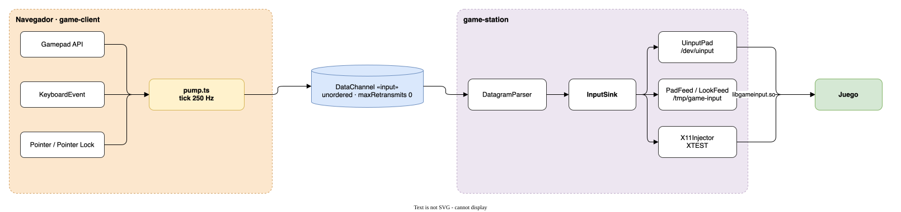

# Input remoto

El navegador envía el estado de gamepads, teclado y mouse por un **DataChannel WebRTC**
llamado `input`. El canal viaja por la misma conexión ICE que el video. La estación lo
decodifica y lo inyecta en el juego.

<p align="center"></p>

## Canal

| Propiedad | Valor |
| --- | --- |
| Label | `input` (lo crea el navegador). |
| Entrega | `ordered: false`, `maxRetransmits: 0`: sin retransmisión y sin orden garantizado. |
| Frecuencia | Tick de 4 ms (250 Hz) en el cliente. Solo hay un datagrama en vuelo: gana el estado más nuevo. |
| Redundancia | Cada datagrama lleva las 2 últimas fotografías (el parser acepta de 1 a 4). |
| Orden | La estación descarta fotografías con `seq` (uint16 circular) no más nuevo que el último aplicado. |

## Formato del datagrama (v3)

Little-endian. Implementado en `game-client/src/webrtc/snapshot.ts` (codificación) y en
`DatagramParser.java` (decodificación).

```
Cabecera (4 bytes)
  0  uint8   magic = 0xA7
  1  uint8   version = 3
  2  uint8   count (1..4), la fotografía más vieja primero
  3  uint8   reservado

Fotografía (13 bytes + variable), repetida `count` veces
  uint16  seq
  uint32  frameId          frame de video que veía el cliente (para correlacionar lag)
  uint8   flags            bit0 mouse · bit1 mouse absoluto · bit2 teclado · bit3 pads
  uint8   mouseButtons     máscara de 5 botones
  int16   x                posición absoluta o delta, según bit1
  int16   y
  int8    wheel
  uint8   nkeys            máx. 24
  uint16  key × nkeys      códigos Linux KEY_* presionados
  uint8   npads            máx. 4
  por pad:
    uint8   slot           0..3
    uint32  buttons        máscara (ver tabla)
    int16   axes[6]        LX, LY, RX, RY (−32767..32767) · LT, RT (0..32767)
```

Un paquete inválido (magic o versión distintos, `count` fuera de rango, longitudes que no
cierran) se descarta y no reinicia el reloj de inactividad.

### Botones del gamepad

Máscara alineada con el *W3C Standard Gamepad* (`game-client/src/webrtc/gamepad.ts`, `WIRE_BTN`):

| Bit | Botón | Bit | Botón |
| --- | --- | --- | --- |
| 0 | A | 10 | LS (stick izq.) |
| 1 | B | 11 | RS (stick der.) |
| 2 | X | 12 | D-pad ↑ |
| 3 | Y | 13 | D-pad ↓ |
| 4 | LB | 14 | D-pad ← |
| 5 | RB | 15 | D-pad → |
| 6–7 | reservados (LT/RT van como ejes) | 16 | Guide |
| 8 | View / Back | | |
| 9 | Menu / Start | | |

El cliente web nunca manda el bit 16 (Guide): ese botón abre el menú de opciones del player
([Navegación con mando](../game-client/README.md#navegación-con-mando)). Mientras el menú está
abierto los pads viajan en reposo.

## Backends en la estación

`InputSink` recibe los bytes en el hilo del DataChannel y los encola. Los pads y X11 se
aplican en hilos dedicados (`input-pads`, `input-x11`), con un solo flush de XTEST por lote.
Qué backends se activan depende de `needs` del manifiesto:

| `needs` | Backend |
| --- | --- |
| `gamepad: N` (1..4) | `UinputPad` (si está habilitado y `/dev/uinput` abre) + `PadFeed`. |
| `keyboard` / `mouse` | `X11Injector` (XTEST sobre `STATION_DISPLAY`). |
| `relativeMouse` | `LookFeed`: el movimiento del mouse va como deltas a SDL (no por XTEST). `libgameinput.so` los entrega como eventos `SDL_MOUSEMOTION` en la cola real de SDL (desde `SDL_PollEvent` o `SDL_PeepEvents`, que usa Cube 2) o, si el juego llama `SDL_GetRelativeMouseState` en cada frame, por esa función. Requiere que la ventana tenga foco de X (`xfocus-game`): ioquake3/OpenArena descarta el mouse sin `SDL_WINDOW_INPUT_FOCUS`. Teclado, botones y rueda siguen por XTEST. |

### Gamepads: uinput y `libgameinput.so`

| Modo | Cuándo | Cómo lo ve el juego |
| --- | --- | --- |
| **uinput** (`input_backend=uinput+padfeed`) | Por defecto, si `/dev/uinput` abre. | Un gamepad Xbox 360 virtual por slot, con VID `0x4174` ("At") y PID `0xC000 + slot`, para no chocar con mandos físicos del host. |
| **sdl_preload** (`input_backend=sdl_preload`) | Sin `/dev/uinput`, o con `CLOUDGAME_INPUT_UINPUT=false`/`0`/`no` en el `env` del manifiesto. | `libgameinput.so` (precargada) crea `CLOUDGAME_VIRTUAL_PADS` joysticks SDL y lee su estado de `/tmp/game-input`. |

Para no duplicar pads, `CLOUDGAME_VIRTUAL_PADS` vale `0` cuando uinput está activo.

`SDL_GAMECONTROLLERCONFIG` se inyecta con un mapping por slot (`SdlMapping`), que coincide
con el orden joydev que registra `UinputPad`: A, B, X, Y, LB, RB, Back, Start, Guide, LS y RS
como botones; gatillos en `ABS_Z`/`ABS_RZ` y D-pad en `ABS_HAT0X/Y`.

`/tmp/game-input` es un archivo mapeado de 4 KB que comparten `PadFeed` y `LookFeed`:

- Bytes 4 y 8: deltas `dx`/`dy` del mouse relativo, sumados atómicamente.
- Desde el byte 64: 4 slots de 32 bytes con magic `PAD0`, `buttons`, 6 ejes y un flag de activo.

### Teclado y mouse (XTEST)

- Las teclas llegan como códigos Linux `KEY_*` y se convierten a keycode X11 sumando 8.
- El mouse absoluto llega en píxeles del **juego** (`STATION_SIZE`), no del video: el cliente lo escala con `gameWidth`/`gameHeight` de `STATE`/`/health`, porque el stream puede ser más chico (`STATION_STREAM_SIZE`). Sin esos campos usa `videoWidth`/`videoHeight`.
- Con pointer lock en el cliente, el mouse viaja como deltas relativos.

## Cliente

| Módulo (`game-client/src/webrtc/`) | Función |
| --- | --- |
| `pump.ts` | Tick de 250 Hz. Arma la fotografía, acumula deltas de mouse y envía. |
| `snapshot.ts` | Codifica el datagrama v3 (`encodeDatagram`). |
| `gamepad.ts` | Lee la Gamepad API (standard mapping) y asigna slots. `PAD_BUTTON_LABELS` alimenta el HUD. |
| `keyboard.ts` | `KeyboardEvent.code` → Linux `KEY_*`. |
| `pointer.ts` | Mouse absoluto mapeado a píxeles del juego (`mapContainPoint`, test en `game-client/test/`), deltas con pointer lock y modo look (`relativeMouse`). |
| `frame.ts` | Reloj de frames del `<video>` para etiquetar `frameId`. |
| `input.ts` | Normaliza `needs` (`gamepad` 0..4 o bool, `keyboard`, `mouse`, `relativeMouse`). |

La Gamepad API solo está disponible en un **contexto seguro** (HTTPS). Además, el navegador
no expone un mando hasta que el usuario presiona un botón.

## Diagnóstico

- `./scripts/check-uinput.sh`: verifica `/dev/uinput` en el host (permisos, módulo y smoke test que crea un pad y lee un evento).
- `./scripts/check-uinput.sh --contenedor`: lo mismo dentro del contenedor `game-station`, con `cloudgame-uinput-smoke`.
- Logs de la estación: `input uinput policy …`, `input_backend=…`, `input open protocol=udp-latest pads=… keyboard=… mouse=…`, `input pad apply slot=…`.
