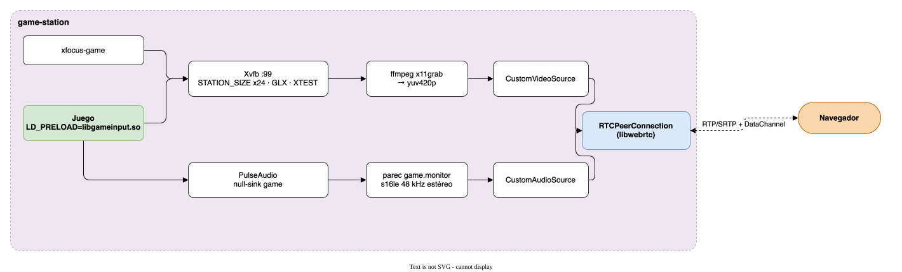

# Video, audio y red

Cómo la Game Station ejecuta el juego, captura su imagen y su sonido, y los entrega al
navegador por WebRTC. Las clases principales son `GameRuntime` y `WebrtcMediaSession`.

## Runtime del juego (`GameRuntime`)

Al hacer `launch` con un manifiesto nativo:

1. **Display virtual**: `Xvfb <STATION_DISPLAY> -screen 0 <STATION_SIZE>x24 -ac +extension GLX +extension XTEST`, seguido de una espera de 400 ms.
2. **Audio**: si `needs.audio` es `true`, comprueba el daemon con `pactl info` (timeout de 2 s). El daemon lo levanta `entrypoint.sh` al iniciar el contenedor. Si no responde, agrega `audio.fallbackArgs` al argv del juego (por ejemplo `--disable-sound`).
3. **Juego**: ejecuta `command` + `args` (interpolados) en `workdir`, con este entorno:

| Variable | Valor | Motivo |
| --- | --- | --- |
| `DISPLAY` | `STATION_DISPLAY` | Dibuja en Xvfb. |
| `vblank_mode`, `__GL_SYNC_TO_VBLANK`, `SDL_HINT_RENDER_VSYNC`, `SDL_RENDER_VSYNC` | `0` | Sin vsync. |
| `NVIDIA_DRIVER_CAPABILITIES` | `all` | Si no viene definida. |
| `SDL_GAMECONTROLLERCONFIG` | mapping del pad virtual | Solo si `needs.gamepad > 0`. Ver [input.md](input.md). |
| `CLOUDGAME_VIRTUAL_PADS` | `0` con uinput; `N` sin uinput | Cantidad de pads que emula `libgameinput.so`. |
| `SDL_MOUSE_RELATIVE_MODE_WARP` | `1` | |
| `SDL_VIDEO_X11_DGAMOUSE` | `0` | |
| `LD_PRELOAD` | `/usr/local/lib/libgameinput.so` | Se antepone a un `LD_PRELOAD` existente. |
| `env` del manifiesto | — | Sobrescribe los defaults anteriores. |

4. **Foco**: lanza `xfocus-game <DISPLAY> 400`, que cada 400 ms toma la ventana visible más grande (mínimo 320x240), la ajusta al display y le da foco.

Todos los procesos quedan en un `ProcessGroup`. En `stop` se destruyen en orden inverso,
incluidos sus descendientes, con 3 s de gracia antes de `destroyForcibly`.

## Video

| Paso | Detalle |
| --- | --- |
| Captura | `ffmpeg -f x11grab -draw_mouse 0 -framerate <STATION_FPS> -video_size <STATION_SIZE> -i <DISPLAY>`, con opciones de baja latencia (`-fflags nobuffer`, `-flags low_delay`, `-probesize 32`, `-flush_packets 1`). |
| Reducción | Si `STATION_STREAM_SIZE` es menor que `STATION_SIZE`: `-vf scale=<W>:<H>:flags=<STATION_STREAM_SCALER>` antes del encoder. El juego sigue a `STATION_SIZE`; OpenH264 codifica menos píxeles. Log: `capture ffmpeg … game=1280x720 stream=854x480 scaler=bicubic`. |
| Formato | `rawvideo` `yuv420p` por stdout. Cada frame completo se copia a un buffer I420 de `CustomVideoSource`. |
| Codificación | libwebrtc (`webrtc-java`). `/health` reporta `encoder=openh264`. El codec negociado se loguea en `answer sent … videoCodec=…`. |
| Parámetros | Al conectar: `maxBitrate = STATION_VIDEO_BITRATE`, `minBitrate` entre 200 y 400 kbps (10 % del máximo), `maxFramerate = STATION_FPS`. `webrtc-java` 0.18 no expone `degradationPreference`. |
| Field trials | `WebRTC-VideoRateControl=webrtc:std`, `WebRTC-LowLatencyRenderer=Enabled`. |
| Métricas | Cada 5 s: `video stats captureFps encodeFps size limit targetKbps encodeMs encoder lost fractionLost rttMs`. |

**Fallback SMPTE**: si el manifiesto es `test-pattern`, no pide `display` o `ffmpeg` no arranca,
un hilo genera barras SMPTE a `STATION_FPS` (mínimo 16 ms por frame) y `/health` reporta
`encoder=smpte`.

## Audio

Solo se captura audio cuando la estación captura un display real.

| Paso | Detalle |
| --- | --- |
| Sink | PulseAudio con `module-null-sink sink_name=game` (`/etc/pulse/game.pa`). ALSA (`asound.conf`) y OpenAL (`alsoft.conf`) están redirigidos a Pulse. |
| Captura | `parec --raw --format=s16le --rate=48000 --channels=2 --device=<STATION_PULSE_SOURCE> --latency-msec=5`. Si `parec` termina en menos de 200 ms, reintenta con `ffmpeg -f pulse`. |
| Envío | Bloques de 10 ms (480 muestras × 2 canales) a `CustomAudioSource`, en un track `game-audio`. |
| Peer | El track de audio se agrega junto al de video en el mismo stream `game`. |

## Red e ICE

La estación usa `ICE_SERVERS` (STUN/TURN) para su `RTCConfiguration`. Antes de enviar cada
candidato local se aplica este filtro:

| Configuración | Candidatos `host` anunciados |
| --- | --- |
| `ICE_HOST_IPS` definido | Solo los que tienen alguna de esas IPs (se ignoran barras finales, por ejemplo `1.2.3.4/`). |
| `ICE_HOST_POLICY=public` (sin `ICE_HOST_IPS`) | Se descartan loopback, link-local y privados (RFC 1918). |
| `ICE_HOST_POLICY=all` (sin `ICE_HOST_IPS`) | Todos. |

Los candidatos `srflx` y `relay` nunca se filtran. Si `ICE_HOST_POLICY=public` y
`ICE_HOST_IPS` está vacío, la estación advierte en el log que ICE suele fallar en LAN.

Como el contenedor corre con `network_mode: host`, los puertos UDP de WebRTC son los del
host. El firewall debe permitir UDP entrante en un rango amplio (ver [Despliegue](../despliegue.md#red-y-firewall)).

## Un peer por estación

- Un solo socket `/ws/webrtc` activo. El segundo recibe `PEER_BUSY`.
- Cerrar el socket cierra el peer, pero no la fuente: el juego y la captura siguen vivos hasta `stop`.
- Cada nuevo `OFFER` cierra el peer anterior y crea uno nuevo sobre la misma fuente de video.
- La factory nativa de WebRTC se crea en `launch`, no al arrancar, para que `/health` no cargue la librería nativa.
