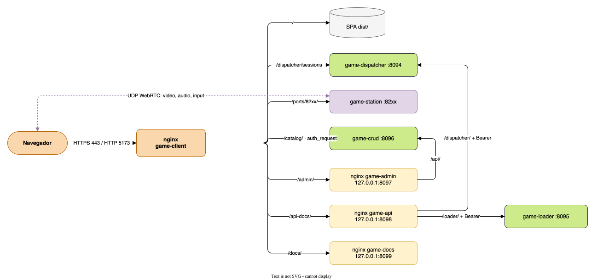

# nginx

Cómo usa el proyecto nginx: qué instancias hay, qué publica cada una, cómo se arma su configuración y
qué tocar cuando se agrega una ruta o un servicio.

## Qué es nginx

[nginx](https://nginx.org/) es un servidor web y **proxy inverso**. Escucha en uno o más puertos y,
según reglas declarativas, hace una de estas dos cosas con cada petición HTTP:

- **Servir archivos estáticos** desde disco (`root` + `try_files`). Así se publican las SPA y los sitios
  ya compilados.
- **Reenviarla a otro servidor** (`proxy_pass`), esperar la respuesta y devolverla al navegador. El
  navegador solo ve a nginx, no al backend.

La configuración se organiza en bloques `server` (un puerto o sitio) que contienen bloques `location`
(reglas por prefijo o regex de la URL). Atiende muchas conexiones con pocos procesos, gracias a un
modelo asíncrono por eventos. Por eso se lleva bien con conexiones largas como WebSocket o SSE.

## Para qué lo usamos

Todo el tráfico HTTP del navegador entra por un único nginx, el de **game-client**. Ese nginx:

1. **Sirve la SPA** del jugador (`dist/` de Vite).
2. **Termina TLS** en `443`. Chrome exige un contexto seguro para WebRTC y la Gamepad API, y los
   backends Java no manejan certificados.
3. **Unifica el origen**: dispatcher, estaciones, catálogo, admin y docs cuelgan del mismo host, así que
   no hay CORS ni *mixed content*.
4. **Decide qué se expone**: limita métodos HTTP por ruta y no publica las APIs internas (API admin del
   dispatcher, loader).
5. **Pide el login** de `/admin/`, `/docs/` y `/api-docs/` con `auth_request` contra game-crud.

game-admin, game-api y game-docs tienen cada uno su **propio nginx interno**. Esos nginx escuchan solo
en loopback y el principal les reenvía las peticiones.

> **El media no pasa por nginx.** El video, el audio y el DataChannel `input` de WebRTC viajan por UDP
> directo entre el navegador y la estación. nginx solo transporta REST y el *signaling* por WebSocket
> (`/ws/control`, `/ws/webrtc`).

<p align="center"></p>

## Instancias

| Instancia | Configuración | Escucha | Rol |
| --- | --- | --- | --- |
| game-client | [`game-client/nginx.conf`](../game-client/nginx.conf) | `80`, `443`, `5173` (todas las interfaces) | Puerta de entrada: SPA, TLS, proxy y login. |
| game-admin | [`game-admin/nginx.conf`](../game-admin/nginx.conf) | `127.0.0.1:8097` (`ADMIN_LISTEN`) | Panel del catálogo; `/api/` → game-crud. |
| game-api | [`game-api/nginx.conf`](../game-api/nginx.conf) | `127.0.0.1:8098` (`DOCS_LISTEN`) | Scalar; agrega los tokens Bearer del loader y del dispatcher. |
| game-docs | [`game-docs/nginx.conf`](../game-docs/nginx.conf) | `127.0.0.1:8099` (`DOCS_SITE_LISTEN`) | Sitio Starlight estático. |

Todas usan la imagen `nginx:1.27-alpine` y corren con `network_mode: host`. Por eso `127.0.0.1` es
el loopback del servidor y no el del contenedor. Al firewall solo se abren los puertos del nginx de
game-client ([Despliegue § Red y firewall](despliegue.md#red-y-firewall)).

## nginx de game-client

### Puertos

| Puerto | Protocolo | Uso |
| --- | --- | --- |
| `443` | HTTPS (TLS 1.2/1.3, HTTP/2) | Acceso principal. Contexto seguro para WebRTC y Gamepad API. |
| `5173` | HTTP | Túnel SSH o LAN. Mismas rutas que `443`, pero Chrome bloquea WebRTC en `http://<IP>`. |
| `80` | HTTP | Solo `/.well-known/acme-challenge/` (Let's Encrypt). El resto responde `301` a HTTPS. |

Los bloques `server` de `443` y `5173` tienen **las mismas `location`**. Si se cambia una ruta, hay que
cambiarla en los dos.

### Rutas

| Ruta | Destino | Métodos | Notas |
| --- | --- | --- | --- |
| `/` | SPA (`/usr/share/nginx/html`) | todos | `try_files $uri $uri/ /index.html`: las rutas de React caen en `index.html`. |
| `= /index.html` | SPA | — | `Cache-Control: no-cache`: un deploy se ve con una recarga normal. |
| `/assets/` | SPA | — | Bundles con hash de Vite: `max-age=31536000, immutable`. |
| `= /dispatcher/sessions` | `${DISPATCHER_UPSTREAM}/sessions` | `POST` | Pedir una partida. |
| `/dispatcher/sessions/<uuid>` | `${DISPATCHER_UPSTREAM}/sessions/<uuid>` | `GET`, `DELETE` | Consultar o liberar la sesión. La API admin (`/stations`, `/pool`) no se expone. |
| `/ports/<8200-8299>/…` | `http://127.0.0.1:<puerto>/…` | todos | Estaciones del loader (modo `deploy-loader.sh`). Con upgrade de WebSocket. |
| `/station/…` | `${STATION_UPSTREAM}/…` | todos | Estación fija (modo `deploy.sh`). Con upgrade de WebSocket. |
| `/stations/<gameId>/…` | `127.0.0.1:$station_port` | todos | Una estación por juego (modo `deploy-all.sh`). `404` si el juego no está en el mapa. |
| `/catalog/(games\|categories\|home\|avatars)…` | `${CRUD_UPSTREAM}/…` | `GET` | Catálogo público de solo lectura (incluye los avatares que puede elegir el jugador). |
| `/media/…` | `${CRUD_UPSTREAM}/media/…` | `GET` | Imágenes del catálogo (archivos de game-crud, `immutable`). Las rutas de `IMAGE` apuntan acá. Quita el `Vary: Origin` de Spring: el banner se pide como `` y con `crossOrigin` (`useImageTint`), y con `Vary` cada petición pisaba la caché de la otra. |
| `/catalog/users…` | `${CRUD_UPSTREAM}/users…` | `GET`, `POST` | Usuarios del inicio de sesión. Provisorio, sin autenticación propia. |
| `= /catalog/friends/events` | `${CRUD_UPSTREAM}/friends/events` | `GET` | Amigos en vivo (SSE, Bearer): `proxy_buffering off` y `proxy_read_timeout 1h`; game-crud manda ping cada 25 s. |
| `/catalog/friends/(playing\|search\|requests…)` | `${CRUD_UPSTREAM}/friends/…` | `GET`, `POST` | Amigos del jugador (Bearer): en partida, buscador y solicitudes (`requests`, `requests/<id>/accept\|reject`). |
| `/catalog/auth/(register\|login\|me\|me/avatar)` | `${CRUD_UPSTREAM}/auth/…` | `GET`, `POST`, `PUT` | Registro, sesión de jugadores y elegir avatar (`PUT /auth/me/avatar`). `/saves` de game-crud **no** se publica: solo lo usan las estaciones por loopback. |
| `/admin/` | `${ADMIN_UPSTREAM}/` | todos | Con login (`auth_request`). `client_max_body_size 32m` para subir imágenes (también en el nginx de game-admin). |
| `/docs/` | `${DOCS_SITE_UPSTREAM}/` | todos | Con login. `/docs` redirige a `/docs/`. |
| `/api-docs/` | `${DOCS_UPSTREAM}/` | todos | Con login. `proxy_buffering off` para el SSE de logs del loader. |

El prefijo de la ruta se quita al reenviar: `proxy_pass ${ADMIN_UPSTREAM}/` con la barra final hace
que `/admin/foo` llegue al backend como `/foo`. En las rutas con regex, el resto de la URL se captura en
una variable con nombre (`$loader_path`, `$catalog_path`…) y se reenvía con `$is_args$args`.

### WebSocket

Las rutas de estación (`/ports/`, `/station/`, `/stations/`) reenvían el *upgrade* de WebSocket:

```nginx
map $http_upgrade $connection_upgrade {
    default upgrade;
    ''      close;
}
# …
proxy_http_version 1.1;
proxy_set_header Upgrade $http_upgrade;
proxy_set_header Connection $connection_upgrade;
proxy_read_timeout 86400s;
proxy_send_timeout 86400s;
```

El `map` manda `Connection: upgrade` solo si el navegador pidió un upgrade. Los timeouts de 24 h evitan
que nginx corte `/ws/control` o `/ws/webrtc` durante una partida sin tráfico de signaling.

### Restricción de métodos

`limit_except` deja pasar solo los métodos listados y responde `403` al resto. Así el catálogo es de
solo lectura desde la SPA, y del dispatcher solo se exponen las tres operaciones de sesión. En las rutas
del dispatcher, además, nginx vacía el header `Origin` (`proxy_set_header Origin ""`), porque el
navegador y el dispatcher comparten origen a través del proxy.

### Login de `/admin/`, `/docs/` y `/api-docs/`

```nginx
location = /_admin_auth {
    internal;
    proxy_pass ${CRUD_UPSTREAM}/admins/verify;
    proxy_pass_request_body off;
    proxy_set_header Content-Length "";
    proxy_set_header Authorization $http_authorization;
}

location /admin/ {
    auth_request /_admin_auth;
    # …
}
```

Antes de atender una ruta protegida, nginx hace una subpetición interna a `GET /admins/verify` de
game-crud con el header `Authorization` del navegador:

- `204` → la petición sigue al backend.
- `401` (con `WWW-Authenticate`) → nginx devuelve `401` y el navegador muestra el diálogo de basic auth.

Los usuarios salen de la tabla `ADMIN` de game-crud ([Game Crud](game-crud/README.md)). Ni game-admin,
ni game-api, ni game-docs implementan autenticación propia.

### Mapa de estaciones por juego

El modo `deploy-all.sh` levanta una estación por juego, cada una en su puerto. La ruta
`/stations/<gameId>/` resuelve el puerto con un `map` de
[`game-client/docker/stations.conf`](../game-client/docker/stations.conf):

```nginx
map $station_game $station_port {
    default "";
}
```

La imagen trae ese mapa vacío, así que la ruta responde `404`. `deploy-all.sh` genera
`.multi/stations.conf` con una línea `<gameId> <puerto>;` por juego y lo monta encima, en
`/etc/nginx/conf.d/stations.conf`.

El modo loader no necesita mapa. La URL ya trae el puerto (`/ports/8203/…`), así que nginx llega a
cualquier estación nueva sin regenerar configuración. El regex cubre solo `8200-8299`: si se cambia
`LOADER_BASE_PORT` en el loader, hay que ajustar `^/ports/(?<loader_port>82[0-9][0-9])/` en
`game-client/nginx.conf` (y el equivalente en `game-api/nginx.conf`).

### Certificado TLS

[`game-client/docker/16-tls-certs.sh`](../game-client/docker/16-tls-certs.sh) se copia a
`/docker-entrypoint.d/`, así que la imagen oficial lo ejecuta antes de arrancar nginx. El script deja el
certificado en `/etc/nginx/certs/tls.{crt,key}`:

| `TLS_CERT` | Comportamiento |
| --- | --- |
| `self` (default) | Autofirmado con `CN=${PUBLIC_HOST}`. Lo regenera si cambia `PUBLIC_HOST`. |
| `acme` | Arranca con el autofirmado. En segundo plano, [lego](https://go-acme.github.io/lego/) pide el certificado de Let's Encrypt con el desafío HTTP-01, que nginx sirve en `:80` desde `/etc/nginx/acme/webroot`. Al obtenerlo o renovarlo, lo instala y ejecuta `nginx -s reload`. Revisa cada `ACME_INTERVAL_S` (6 h por defecto). |

`/etc/nginx/acme` es el volumen `./.acme`, así que la cuenta y los certificados sobreviven a recrear el
contenedor. Más detalle en [Despliegue § HTTPS](despliegue.md#https).

## nginx internos

### game-admin

Sirve el panel (SPA, con `try_files … /index.html`) y reenvía `/api/` a game-crud. Como el panel
llama a `/admin/api/…` en el mismo origen, no hace falta CORS. El nginx principal ya validó el login
antes de llegar acá.

### game-api

Sirve Scalar y los specs de `openapi/` (los `.yaml` con `no-cache`). Además hace de proxy para el
botón "Probar":

| Ruta | Destino | Qué agrega nginx |
| --- | --- | --- |
| `/crud/` | `${CRUD_UPSTREAM}/` | — |
| `/loader/` | `${LOADER_UPSTREAM}/` | `Authorization: Bearer ${LOADER_API_TOKEN}`; `proxy_buffering off` para el SSE de logs. |
| `/dispatcher/` | `${DISPATCHER_UPSTREAM}/` | `Authorization: Bearer ${DISPATCHER_API_TOKEN}`. |
| `/station/<8090\|82xx>/…` | `http://${STATION_HOST}:<puerto>/…` | — |

Los tokens viven solo en el entorno del contenedor y **nunca llegan al navegador**. Quien entra a
`/api-docs/` ya pasó el basic auth del admin.

### game-docs

Sirve el build estático de Starlight. Usa `absolute_redirect off` y `try_files $uri $uri/index.html`
(sin `$uri/`), para que nginx no genere redirecciones que pierdan el prefijo `/docs`. Los assets con
hash (`/_astro/`) se cachean un año.

## Variables de entorno en la configuración

Ningún `nginx.conf` tiene los upstreams fijos. Cada Dockerfile copia su `nginx.conf` como plantilla
(`/etc/nginx/templates/default.conf.template`). Al arrancar, el entrypoint de la imagen oficial reemplaza
las `${VAR}` con `envsubst` y escribe el resultado en `/etc/nginx/conf.d/default.conf`.

`NGINX_ENVSUBST_FILTER` limita qué variables se sustituyen. Es necesario porque nginx tiene sus propias
variables con la misma sintaxis (`$host`, `$http_upgrade`…), y esas tienen que quedar intactas.

| Imagen | Variables (`NGINX_ENVSUBST_FILTER`) | Defaults |
| --- | --- | --- |
| game-client | `STATION_UPSTREAM`, `DISPATCHER_UPSTREAM`, `ADMIN_UPSTREAM`, `DOCS_UPSTREAM`, `DOCS_SITE_UPSTREAM`, `CRUD_UPSTREAM` | `http://127.0.0.1:` `8090`, `8094`, `8097`, `8098`, `8099`, `8096` |
| game-admin | `ADMIN_LISTEN`, `CRUD_UPSTREAM` | `127.0.0.1:8097`, `http://127.0.0.1:8096` |
| game-api | `DOCS_LISTEN`, `CRUD_UPSTREAM`, `LOADER_UPSTREAM`, `LOADER_API_TOKEN`, `DISPATCHER_UPSTREAM`, `DISPATCHER_API_TOKEN`, `STATION_HOST` | `127.0.0.1:8098`, `…:8096`, `…:8095`, vacío, `…:8094`, vacío, `127.0.0.1` |
| game-docs | `DOCS_SITE_LISTEN` | `127.0.0.1:8099` |

`PUBLIC_HOST`, `TLS_CERT`, `ACME_EMAIL`, `ACME_SERVER`, `ACME_PROFILE` y `ACME_INTERVAL_S` no son de la
plantilla: los lee `16-tls-certs.sh`. Los valores por despliegue se pasan en `environment:` de
`compose.loader.yaml`, `compose.yaml` o el `compose.multi.yaml` que genera `deploy-all.sh`.

## Desarrollo local

En `npm run dev` no hay nginx. El proxy de Vite ([`game-client/vite.config.ts`](../game-client/vite.config.ts))
reproduce los prefijos principales: `/station`, `/dispatcher`, `/catalog` y `/media` (destinos en
`STATION_PROXY_TARGET`, `DISPATCHER_PROXY_TARGET` y `CRUD_PROXY_TARGET`), y `/ports` solo si se define
`PORTS_PROXY_TARGET`. Las
restricciones de métodos y el login **solo existen en nginx**: en desarrollo no se aplican.

## Cambios frecuentes

| Necesidad | Qué tocar |
| --- | --- |
| Exponer una ruta nueva al navegador | Agregar la `location` en los **dos** `server` (`5173` y `443`) de `game-client/nginx.conf`, con el `limit_except` más restrictivo posible. Si usa Vite en desarrollo, replicar el prefijo en `vite.config.ts`. |
| Nuevo upstream configurable | Usar `${NUEVA_VAR}` en la plantilla, sumarla a `NGINX_ENVSUBST_FILTER` y darle un `ENV` por defecto en el Dockerfile. |
| Proteger una ruta con el login del admin | `auth_request /_admin_auth;` dentro de la `location`. |
| Cambiar el rango de puertos del loader | Regex de `/ports/` en `game-client/nginx.conf` y de `/station/` en `game-api/nginx.conf`. |
| Respuestas en streaming (SSE) | `proxy_buffering off;` y un `proxy_read_timeout` largo. |

Para validar la sintaxis sin desplegar, con la imagen ya construida:

```bash
docker run --rm --network host cloudgame/game-client:loader nginx -t
```

Para ver la configuración final con las variables ya sustituidas:

```bash
docker exec <contenedor-game-client> cat /etc/nginx/conf.d/default.conf
```
